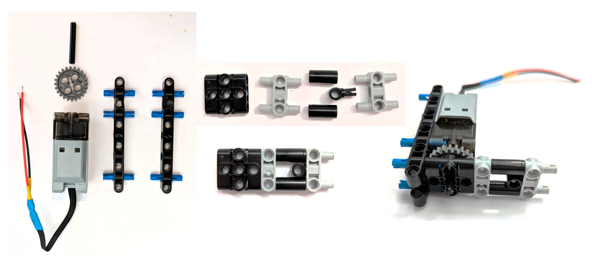
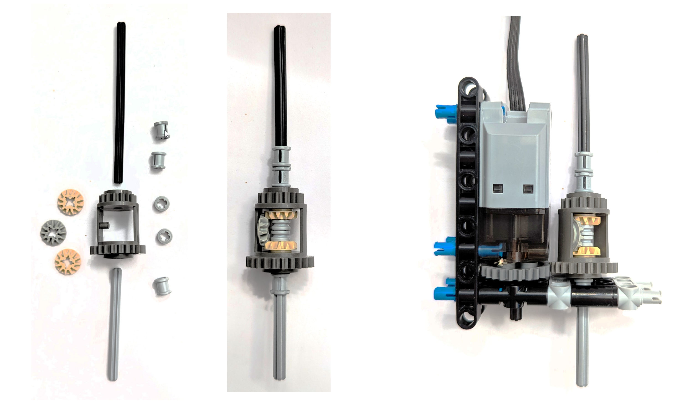
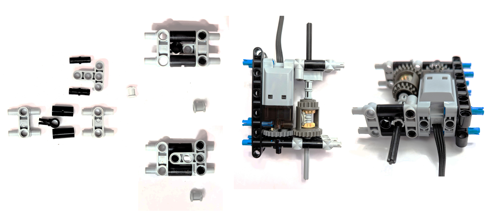
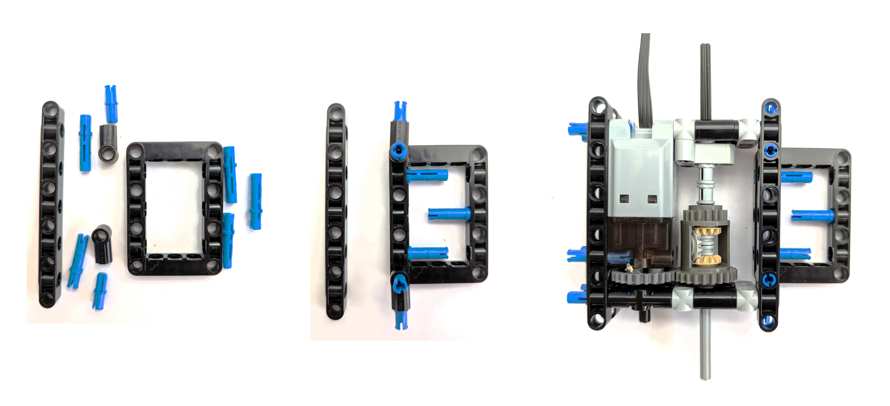
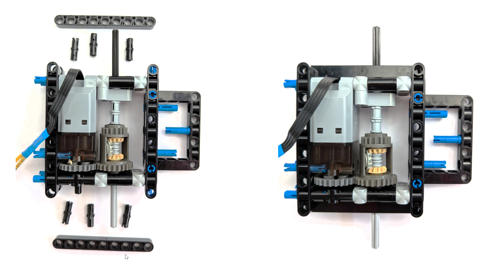

# Building Instructions

In this section, we give step-by-step instructions how to rebuild our car.
The driving base and structural elements to support the electronics are mostly built of lego parts. 
At some places, we have cut the original parts to fit.

## Rear Axle and Motor Block
Start with the rear axle. Assemble the back side and attach the motor, the the right side.

Now assemble the axle and the differential gears.

Then add the left side.

Close the casing and add the support for the battery.

Finally, add the side beams to hold the axle stoppers in place. 
With those, the axle parts cannot come loose and let the wheel fall off.

Now the rear axle box is a firm block and cannot come off in any pulling direction.

## Front Axle and Steering

[Back to main page](../README.md)
