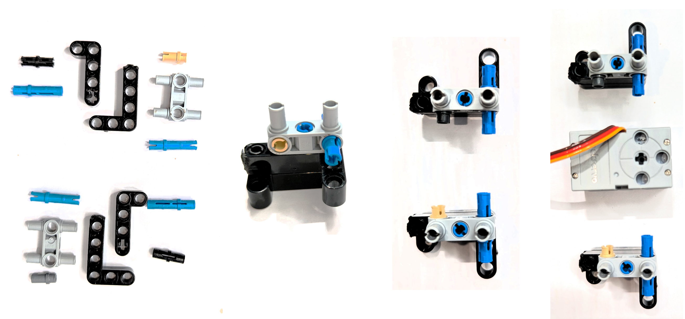
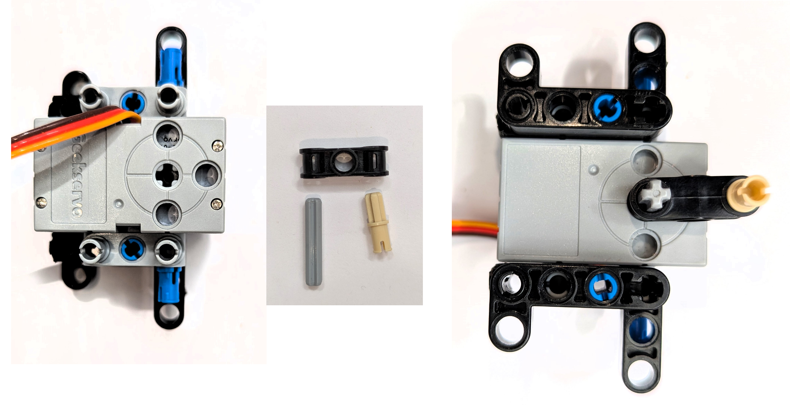
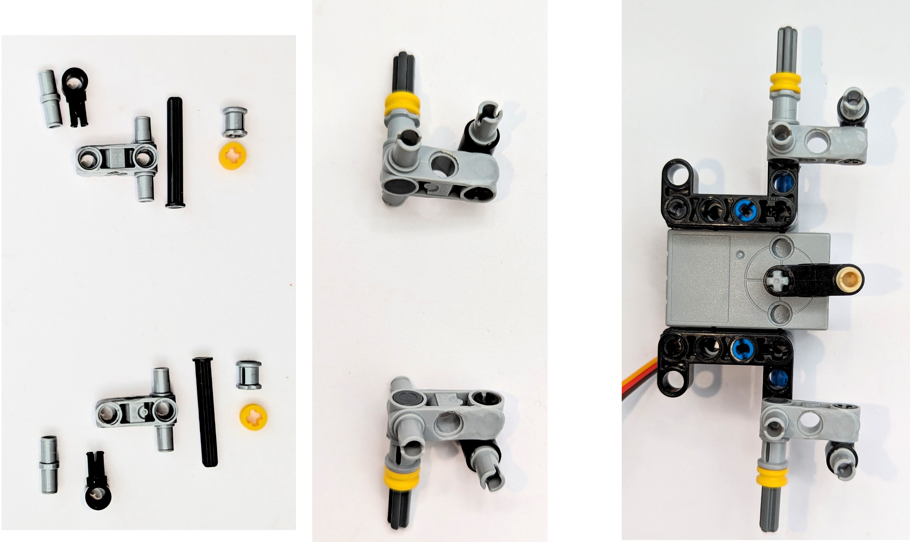
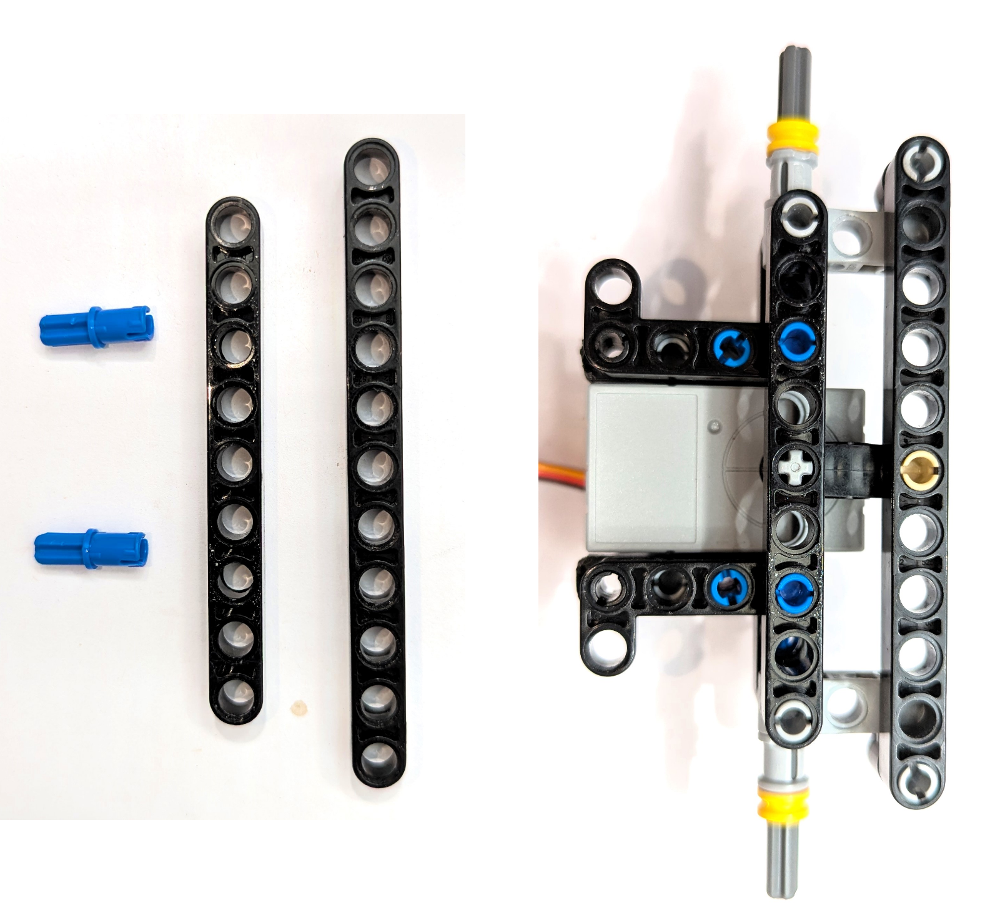
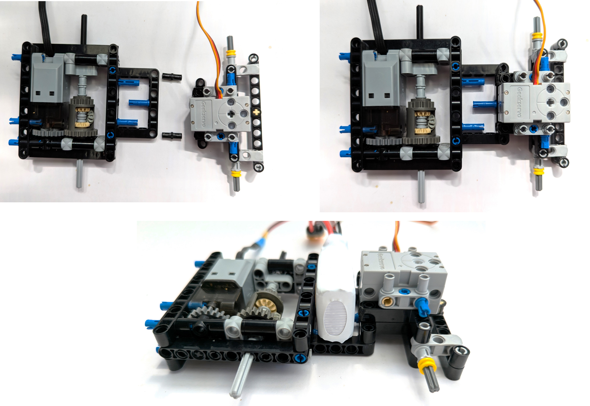
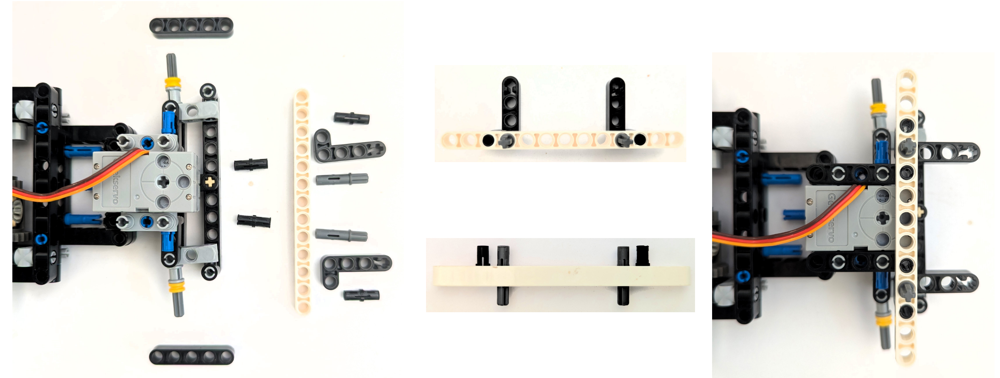
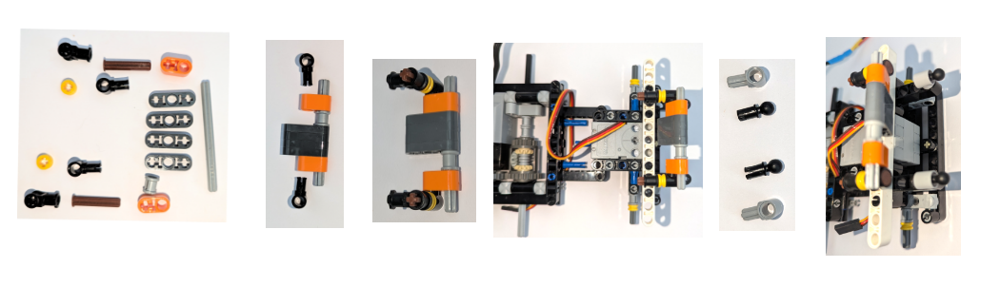
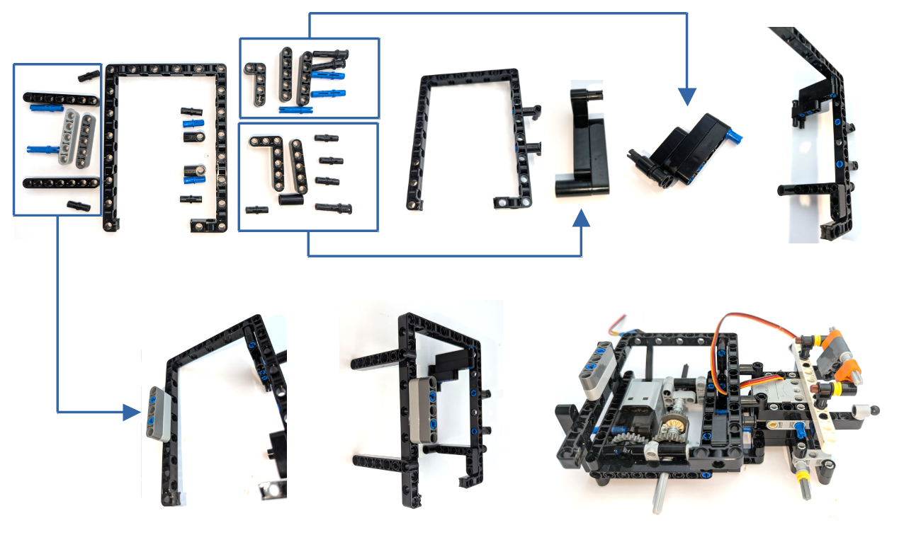
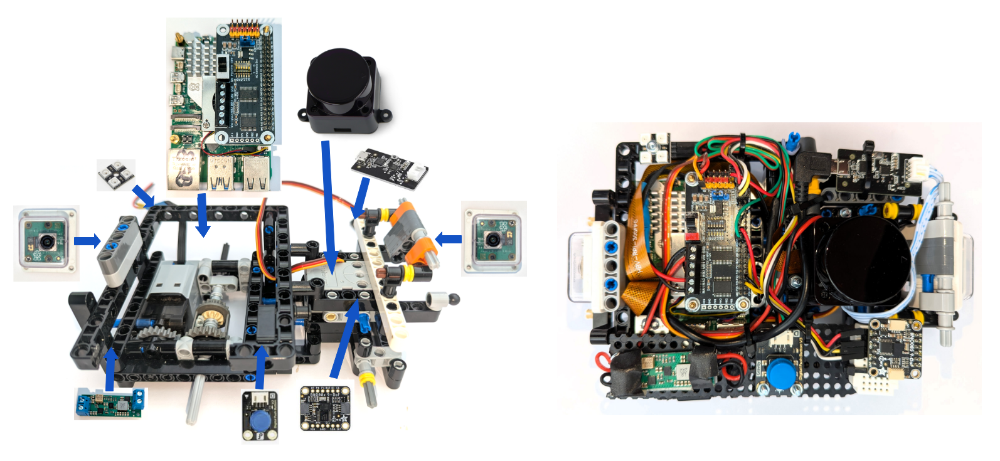

# Building Instructions

In this section, we give step-by-step instructions how to rebuild our car.
The driving base and structural elements to support the electronics are mostly built of lego parts. 
At some places, we have cut the original parts to fit.
We also provide a [**bill of materials**](#bill-of-materials). 
However, we have not listed every single lego technic element on this list as these can easily be seen in the building instructions photos.

## Rear Axle and Motor Block
Start with the rear axle. Assemble the back side and attach the motor, the the right side.

Now assemble the axle and the differential gears.

Then add the left side.

Close the casing and add the support for the battery.

Finally, add the side beams to hold the axle stoppers in place. 
With those, the axle parts cannot come loose and let the wheel fall off.

Now the rear axle box is a firm block and cannot come off in any pulling direction.

## Front Axle and Steering

To save space, the steering servo is integrated in the front axle.
Start with the right and left supporting structures for the main front axle and the connection to the steering servo.

Connect the steering lever to the servo.

Now build and attach the right and left steering arms. 

Finally add the beams to complete the main front axle and attach the tie rod.

## Driving Base

Now connect rear axle box and front axle to form the complete driving base.

## Electronics

To mount the electronic elements as controllers and sensors, we have added some supporting structures.
Front side supporting structures:

rear side supporting structures:

Electronics placements:

## Bill of Materials

- 1x Raspberry Pi5 8GB
- 1x Raspberry Pi Cooling Fan
- 2x Raspberry Pi Cameramodul V3 Wide
- 1x 30cm CSI Cable f. Raspberry Pi5/Zero
- 1x15cm CSI Cable f. Raspberry Pi5/Zero
- 1x Seengreat Motor- and Servo HAT
- 1 x Adafruit 9-DOF IMU BNO085 (Gyro and accel sensor)
- 1 x DFRobot STL-19P Lidar Set
- 1 x Pololu U3V70A Step-Up Module adjustable
- 1 x CaDa L-Motor Pro CJV5074(Lego power functions compatible)
- 1 x Geekservo Elecfreaks 360 grey Lego-compatible servo motor
- 1 x 7.4V 1100mAh Red Power Lipo battery
- 1 x XT60 socket with power cable
- 1 x DFRobot digital button
- 1 x 2x2 WS2812 RGB LED Matrix
- 1 x Micro-USB to USB-A cable angled, 20cm
- 2 x Aluminium stripe with holes
- 2 x Arducam RPI camera housing
- 4 x Lego Spike Prime small wheels 43x14 mm
- var. M3 und M2,5 metal screws with fasteners
- 1 x Mini-Breadboard 55 connections
- var. JST breadboard cables
- Raspberry Pi standoffs with screws and fasteners
- var. Lego Technic parts, see building instructions photos for details
- 10x10 cm plastic plate with holes from DIY shop

[Back to main page](../README.md)
