Roadrunners – Future Engineers 2026
====

  

## Table of Contents

- [Introduction](#introduction)
    - [The Team](#the-team)
	- [Season 2026 Engineering Goals](#season-2026-engineering-goals)
- [Overview](#overview)
	- [Roadrunner Fact Sheet](#roadrunner-fact-sheet)
	- [Car Photos](#car-photos)
- [Mobility & Mechanical Design](#mobility--mechanical-design)
	- [Driving Base](#driving-base)	
    - [Steering Mechanism](#steering-mechanism)
    - [Motorization](#motorization)
	- [Controllers](#controllers)
- [Power & Sense Management](#power--sense-management)  
    - [Sensors](#sensors)
		- [LiDAR](#lidar)
		- [Cameras](#cameras)
		- [Gyro](#gyro)
	- [Power Management](#power-management)
		- [Power Consumption Check](#power-consumption-check)
		- [Power Supply](#power-supply)
		- [Power Distribution](#power-distribution)
		- [Wiring Diagram](#wiring-diagram)
- [Software Architecture & Obstacle Strategy](#software-architecture--obstacle-strategy)
- [Debugging & Testing](#debugging--testing)
- [Overall System & Engineering Decisions](#overall-system--engineering-decisions)
	- [Development Goals](#development-goals)
	- [Design Trade-Offs](#design-trade-offs)
- [Appendices](#appendices)
	- [Hardware Bill of Materials](#hardware-bill-of-materials)
	- [Software Modules](#software-modules)
	- [Resources](#resources)

# Introduction

Welcome to the GitHub hub of **Team Roadrunners**, proudly representing **Germany⚫🔴🟡** at the **WRO World Final 2026**!
This repository contains all the code, documentation, and resources for our project. We have used scoring criteria from the rulebook as headings in our documentation to make it easy to navigate through our repository.

## The Team

Paul Krohn

Ben Lüttecke

## Season 2026 Engineering Goals

We have analyzed the strengths and weaknesses of our 2025 Future Engineers car. From that, we defined the goals for this season's car.

Strengths in 2025 car:
- camera model, position and FoV require only few processing to exclude non-game field areas
- footprint size small enough to pass between obstacle and near wall with enough headroom
- min-max speed range
- IMU/Gyro stability
- LEDs for Debugging and Testing

Weaknesses in 2025 car:
- weight: too heavy for single motor
- turning radius too large
- parallel parking too often touches a pink wall
- dead angles in obstacle and wall detection too large

To improve at the weaknesses, a lot of technical decisions were necessary. As we discovered, many of them were not independent from each other and had impacts on strengths we wanted to keep.
So at various points, design trade-offs were necessary between conflicting goals. 

A major point in improvements was to use a LiDAR for sensing distances and mount it in a way that it has a free 360 degree field of view. We felt this would be helpful in solving various previous weaknesses during driving and parking. However, this goal had major implications on how to build the chassis and which electronics can be used. A detailed discussion is provided in the sections about chassis and LiDAR sensor.

We sum up all the design trade-offs and the reasons for the final decisions in detail in the section [**Overall System & Engineering Decisions**](#overall-system--engineering-decisions).

We thought a LiDAR sensor would solve a lot of our dead angle problems. However, to be useful when manoeuvring within the parking box and while driving on the parcours as well, it would ideally have a full 360 degree unblocked field of view. 

- Goal 1: Redesign chassis to support a true 360 degree FoV LiDAR

- Goal 2: Achieve better agility (smaller turning circle)

- Goal 3: Redesign Software to make use of 360 degree LiDAR

- Goal 4: Increase maximum speed

  

Apart from specific goals for this season, we have defined some general engineering rules for ourselves.

- Precision before speed  
A better precision makes it more likely to run without driving errors. So it ranks higher than running at higher speed.

- Test new ideas early  
Test early whether a new idea is helpful with prototypes. Find drawbacks as early as possible.

- Always have a backup

  

# Overview

  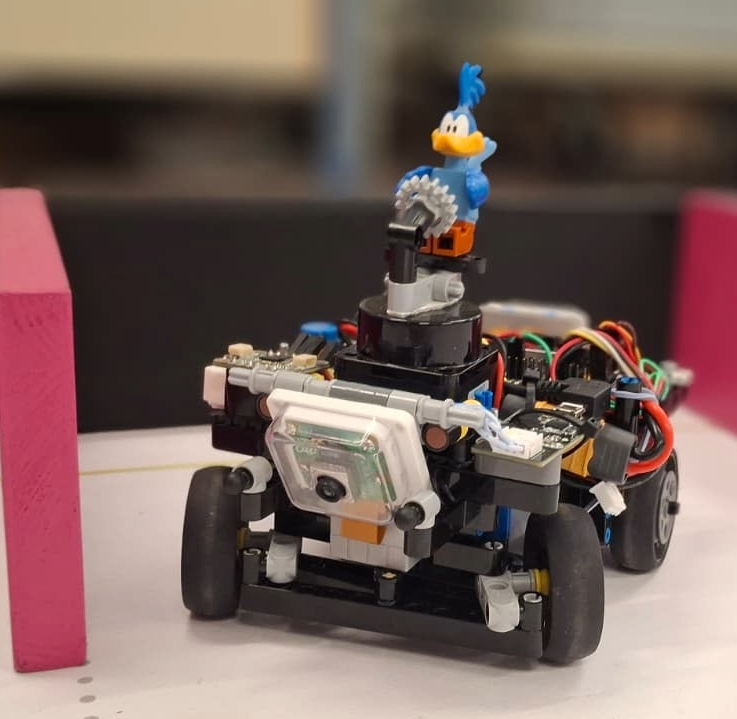

## Roadrunner Fact Sheet

| Property                  | Value                                                        |
| ------------------------- | ------------------------------------------------------------ |
| Height                    | 9.5 cm                                                       |
| Width                     | 13,5 cm                                                      |
| Length                    | 18,8 cm                                                      |
| Weight                    | 572 g                                                        |
| Speed Range               | min: 0.13 m/sec  max: 1.58 m/sec                             |
| Overall power consumption | 16.2 W                                                       |
| Chassis build system      | Lego Technic  (mostly)                                       |
| Motorization              | lego-compatible motor driving rear axle, 1:1 gearbox connection, no encoder |
| Steering system           | Ackermann front  steering with differential rear axle        |
| Power Supply              | 2S 7.4V 1100 mAh Lipo Battery                                |
| Sensing system            | 2 RPI cams, 360 degree LiDAR, IMU (Gyro+Acceleration)        |
| Controller                | Raspberry Pi5 8 GB + Motor and Servo HAT                     |
| Programming               | Python                                                       |

## Car Photos
Here is an overview of our final car design. High-resolution photos can be found in [**v-photos**](./v-photos/README.md). 
<table> <tr> <td align="center">
    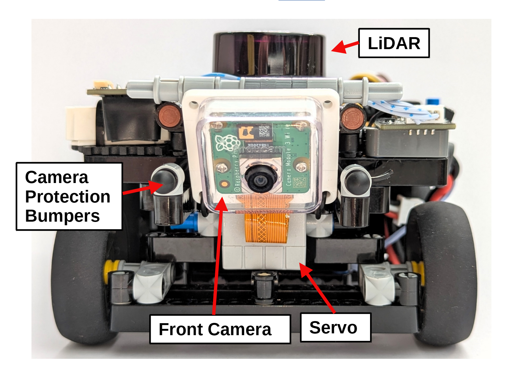 Front View</td> <td align="center">
        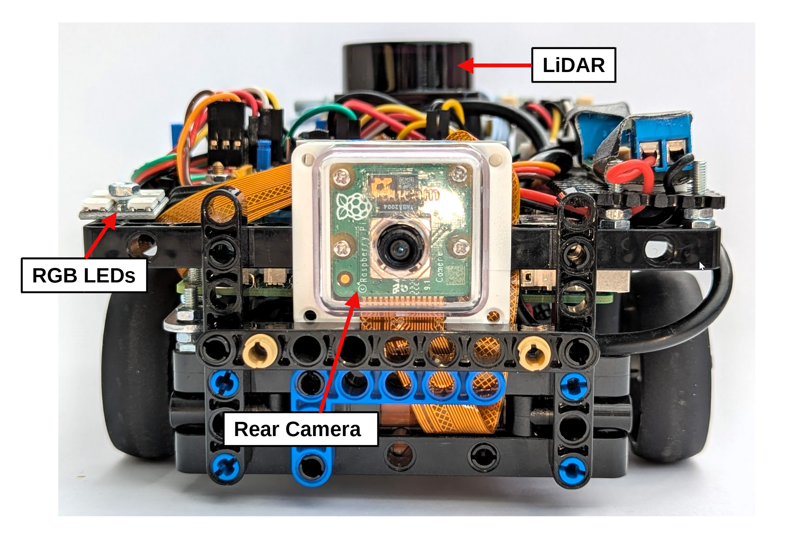 Back View</td> </tr> <tr> <td align="center">
            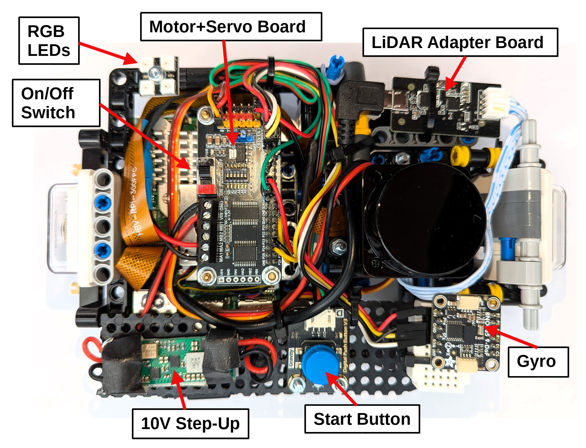 Top View</td> <td align="center">
                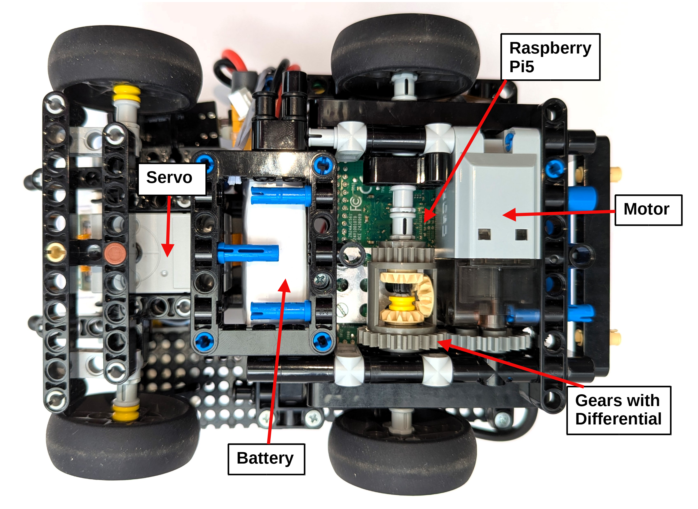 Bottom View</td> </tr> <tr> <td align="center">
                    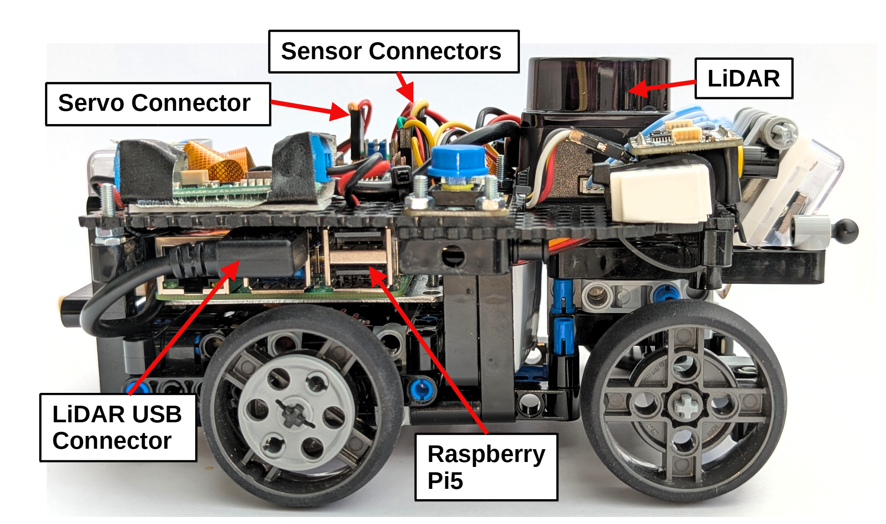 Right Side</td> <td align="center">
                        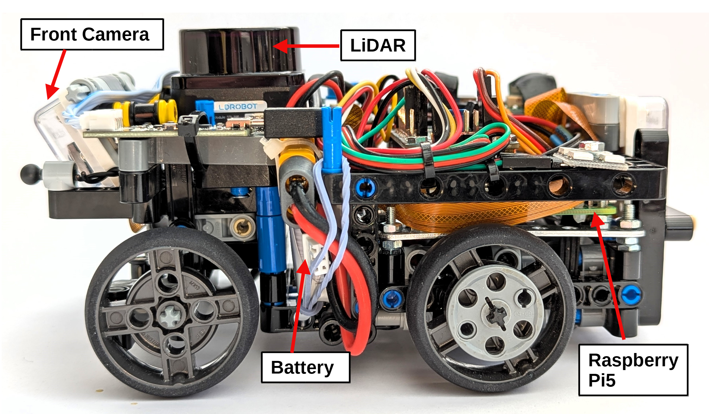 Left Side</td> </tr> </table>

# Mobility & Mechanical Design 

The chassis of the Roadrunner is constructed in two layers: 
- the driving base consists of a rear axle block with motor and gearing and the front axle block containing the steering mechanism and servo
- the electronics layer contains controllers and sensors

Our previous roadrunner car has been built from lego technic parts and we decided to keep it that way. Lego Technic is a rather sturdy material and we have lots of technic parts from other lego robotic projects in the past. 

The alternative would have been to build the chassis in 3D-printing. However, rapid prototyping, testing new ideas, new placements, other gearings etc is faster with already pre-produced parts and later changes, e.g. for surprise rules, are easier to be applied to a lego chassis.

To be able to use a LiDAR with 360 degree FoV (goal 1 for this season, see above), 

- the LiDAR must be mounted so its sensor's plane of rotation is significantly below 10 cm wall and obstacles height

- all other chassis and electronics elements must be placed below the LiDAR sensor's plane of rotation.

  

## Driving Base

The first step in flattening the driving base was to use smaller wheels. In our previous car, we used 56x14 mm Lego Spike Prime wheels, which performed well.
This year, we used the smaller variant, the 43x14 mm Spike Prime wheels. With those, there is still enough ground clearance for a Lego motor.

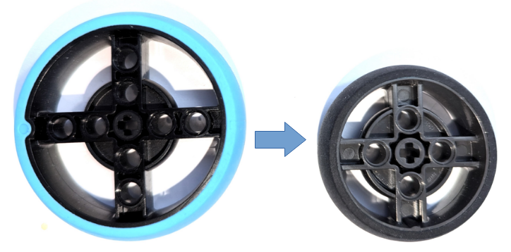

- Advantage: new wheels have same width and grip as before but save height in axle position and overall height.
- Disadvantage: smaller wheels decrease the maximum speed and therefore contradict goal 4. 

According to rule precision before speed, this is acceptable.

### Steering Mechanism

To achieve goal 3, more agility, we tested some steering system variants.

**Steering Geometry**

The first step was to change the steering mechanism from a parallel steering geometry to Ackermann steering geometry.

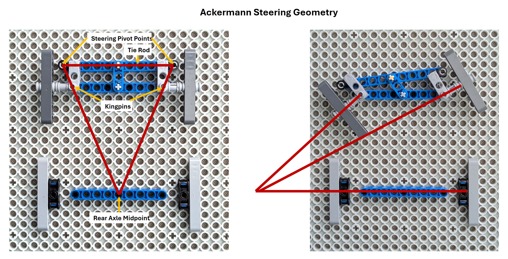

There are two options how to build an Ackermann steering geometry, place the tie rod behind or in front of the axle.
Both options had pros and cons. To find out the best configuration for our car, we had to run realistic tests.

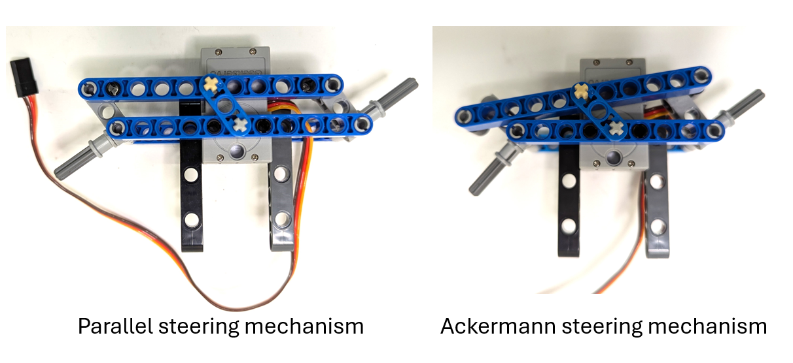

Our previous car had a fixed rear axle with two motors attached to it with a gearbox (see motorization). 
In theory, to get the most out of Ackermann steering, the rear axle should have a differential.
A differential gear in the rear axle would result in tighter turning circles as it allows the inner wheel of the rear axle to turn slower than the outer wheel and therefore run a smaller circle. 
However, as space is tight and we must keep the driving base as flat as possible, this means to sacrifice a motor. 

To find out which Ackermann Configuration works best and whether it is worth to rethink the motorization, we built a minimum test driving base and ran turning performance tests. We ran each combination several times and then calculated an average value for the measured turning circle. We measured the turning circle from outer rear wheel to outer rear wheel to be sure this is the minimum space our car needs to turn around in one go.

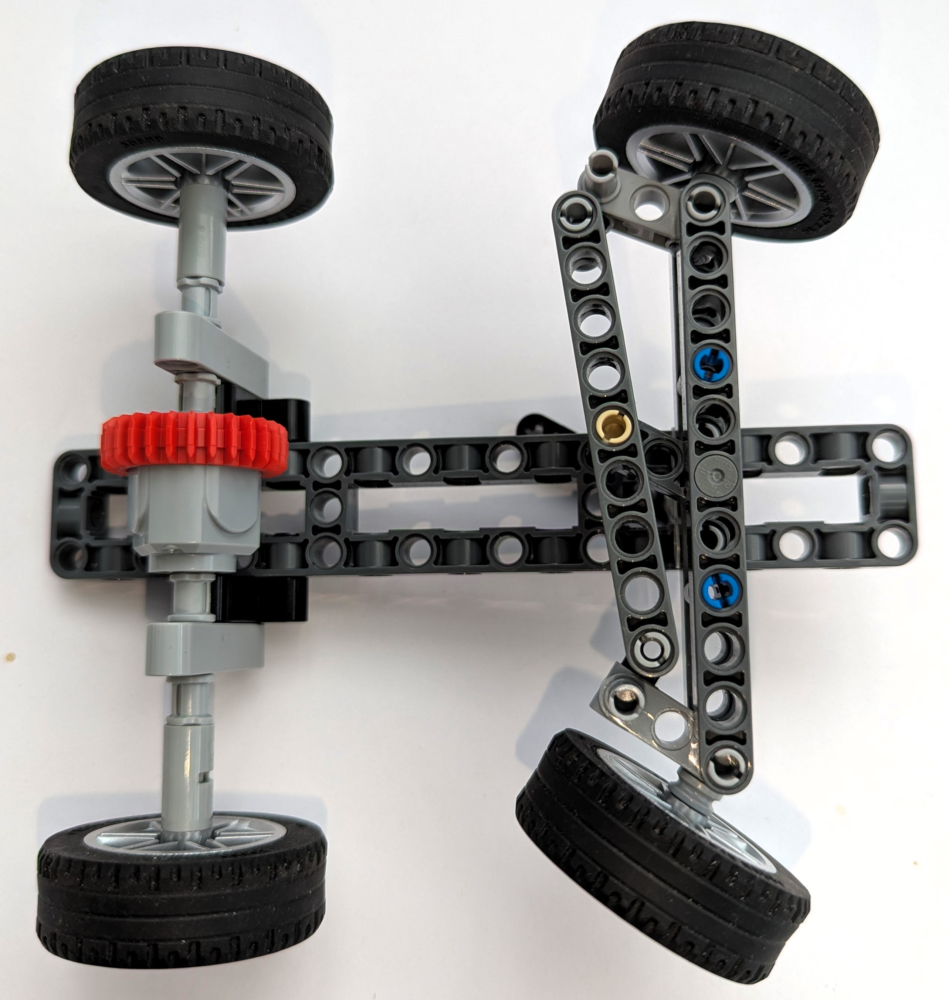

**Tie rod behind front axle (classic Ackermann)**

| Configuration          | Turning circle width |
| ---------------------- | -------------------- |
| fixed rear axle        | 49.5 cm              |
| with differential gear | 43 cm                |

**Tie rod in front of front axle** 

| Configuration          | Turning circle width |
| ---------------------- | -------------------- |
| fixed rear axle        | 33.5 cm              |
| with differential gear | 31.5 cm :heavy_check_mark:  |

Decision: The configuration with tie rod in front of the rear axle and differential gear is best, we build that one. 
The gained agility is worth using a differential gear.

Steering Servo selection: see Motorization

The resulting driving base looks like this:

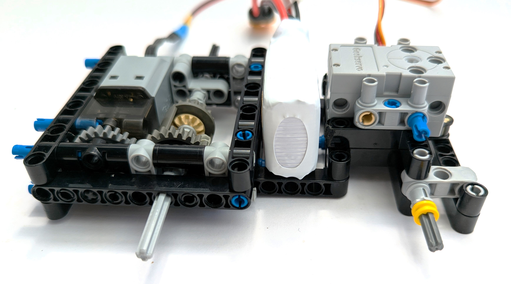

| Driving Base dimensions |         |
| ----------------------- | ------- |
| track width front       | 11.2 cm |
| track width rear        | 12 cm   |
| wheelbase               | 9 cm    |

### Motorization

**Driving Motor Options**

We needed a motor compatible to the Lego Power Functions L motor form factor to fit seamlessly in our driving base. We had decided to change our last years motor configuration to only one motor with a differential gear.  So we tested two possible motors together with two variants of differential gears. One gearbox provided a 1:1 gear ratio, the other one a 20:28 = 1:1.4 ratio reducing speed but increasing torque.

Goal: Choose a motor and gear combination, that

- has enough torque at low voltage to drive our car slow enough for parking
- has enough rpm to drive fast enough to get good round times

Torque needed to get rolling: 

Weight: 572g,  Wheel radius:  22mm,  estimated rolling friction coefficient: 0.05
$$
Force: F =0.57 kg  * 9.81 m/s^2 * 0.05 = 0.28 N
$$

$$
Torque wheel: M = 0.28 N * 0.022 cm = 0.006 N/cm
$$

CaDa does not publish official numbers on torque, but community tests (YouTube) demonstrated it having more torque than the original Lego PF-L motor or Mould King L motor. To be sure about the performance, we tested with both motors in our car.

|                      | Mould King M3                                            | CaDa L Motor Pro                                             |
| -------------------- | -------------------------------------------------------- | ------------------------------------------------------------ |
|                      | 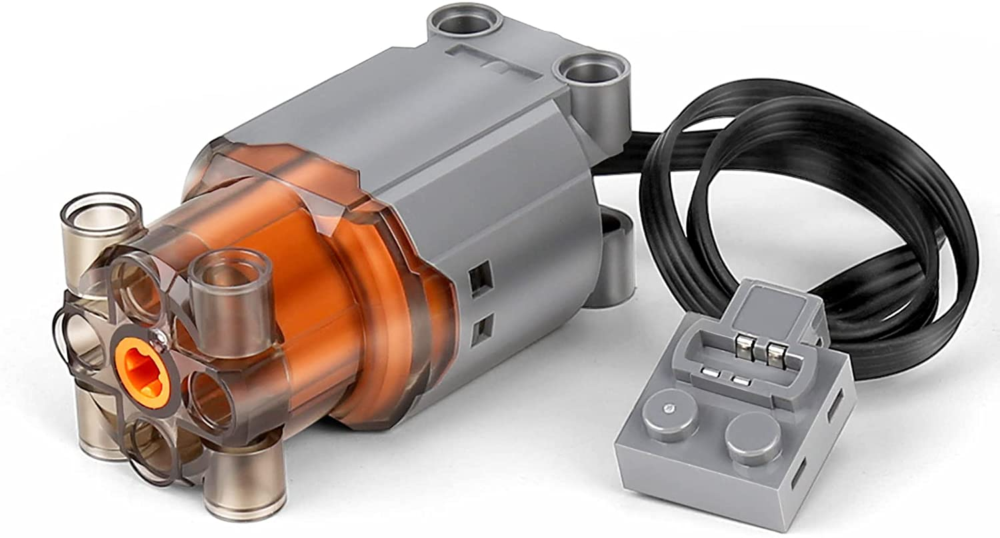 | 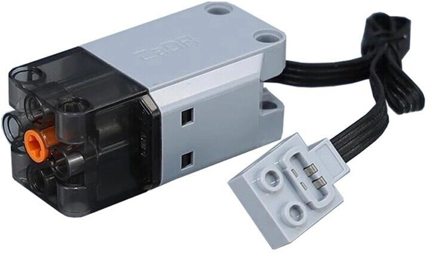 |
| no load rpm          | 500 r/min                                                | 1200 r/min                                                   |
| voltage              | 9V                                                       | 9V                                                           |
| min speed 1:1 gear   | 0.14 m/sec                                               | 0.13 m/sec                                                   |
| min speed 1:1.4 gear | 0.1 m/sec                                                | 0.1 m/sec                                                    |
| max speed 1:1 gear   | 1.1 m/sec                                                | 1.58 m/sec                                                   |
| max speed 1:1.4 gear | 0.85 m/sec                                               | 1.13 m/sec                                                   |
|                      |                                                          | :heavy_check_mark:                                           |

The CaDa minimum speed  at 1:1 gear ratio is still slow enough to drive safely in the parking box an it has the best maximum speed. Additionally, it has metal internal gears which are sturdier than the plastic gears of the Mould King.

Decision: We use the CaDa L Motor Pro with the 1:1 ratio differential gear.

**Steering Servo Options**

|             | Geekservo Grey 360 | MG90S Micro Servo |
| ----------- | ------------------ | ----------------- |
|             |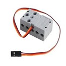|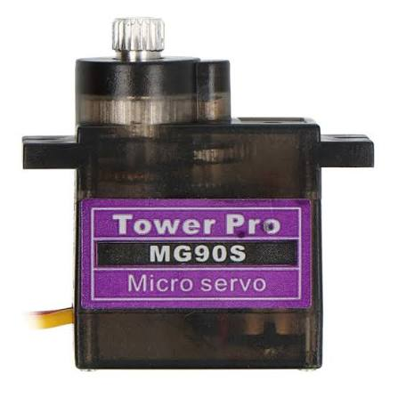|
| Voltage     |       4.8 - 6V     |   4.8 - 6V        |
| Torque      |   2 kg/cm at 5V (20N/cm)   |   2 kg/cm at 5V (20N/cm)   |
| Weight      |        20g         |       13.4g       |
| Form Factor |     24x24x40mm     |     23x12x29mm    |
|  | :heavy_check_mark: |  |

The MG90S is a little bit lighter than the Geekservo. 
The Geekservo has a housing with lego connections, so it can be used as a structural element and combines with Lego very easily.
The MG90s requires additional structural elements to build it in, which reduces the weight advantage.
We already used the Geekservo last year and it worked well, so decision is to keep it.

## Controllers

As main controller, we use a Raspberry Pi 5.

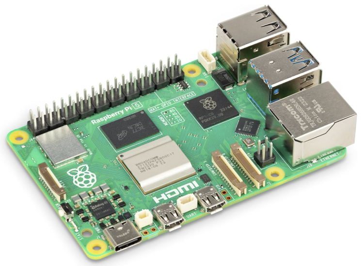

Our previous car had a Raspberry Pi as its main controller and separate motor driver board, servo driver board and step downs.
This needed a lot of space. For this years goal, build as flat as possible, we wanted to use an integrated HAT providing all or most of these functions with a much smaller footprint.
We evaluated 3 different models: 
Adeept Robot HAT V3, Waveshare general Driver Board and Seengreat Motor and Servo HAT.
All 3 fulfilled the requirements:

- motor driver
- servo driver
- 5V step-down
- can power the Raspberry Pi directly
- main on/off switch

The 5V step-downs all supported up to 3A, so no difference here.
So we used the resulting height and width and ease to attach sensors as the criterion to select one.
On the images right to left: Adeept, Waveshare, Seengreat

Height:

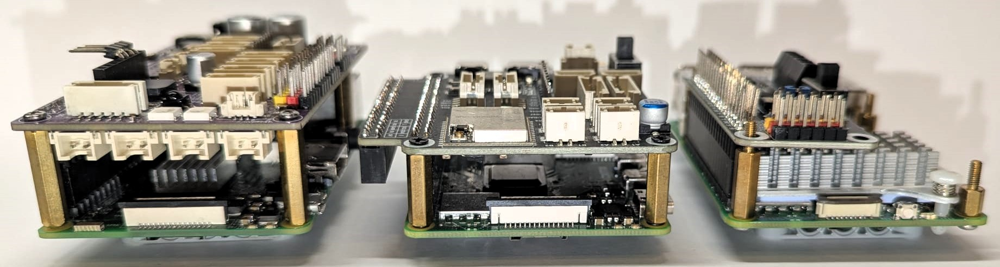

Adeept is higher that the others, which is bad for the LiDAR mounting position.
Additionally, Raspberry Pi headers are not directly accessible

Width:

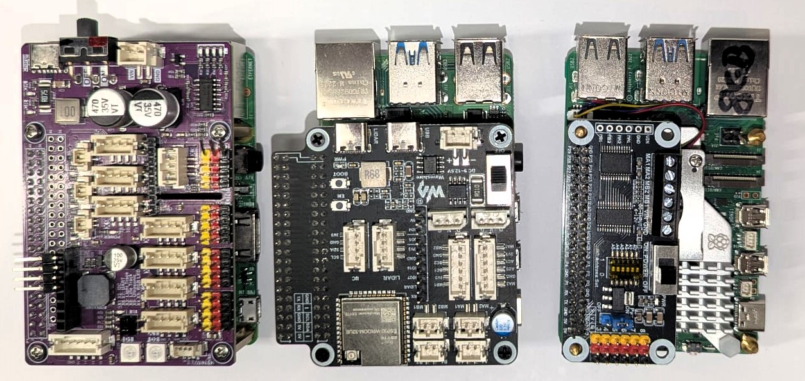

The Waveshare is broader that the others and the Headers are not easy accessible.
The Seengreat has the smallest footprint (Bonnet form factor) and all Raspberry Pi headers are freely accessible.
We chose the Seengreat Motor and Servo Driver HAT.
Drawback: The Seengreat has only one PWM Driver (PCA9685) for both servo and motor pwm.
The servo needs 50 Hz pwm frequency. Motors typically use much higher frequencies to avoid rattling at slower speeds.
However, this is not possible with only one PWM controller.
The CaDa motor rattled a lot less than the other motors tested, so motor rattling is not an issue with this one.

### Mounts for electronics

To mount the electronic elements as controllers and sensors, we added some structural supports.

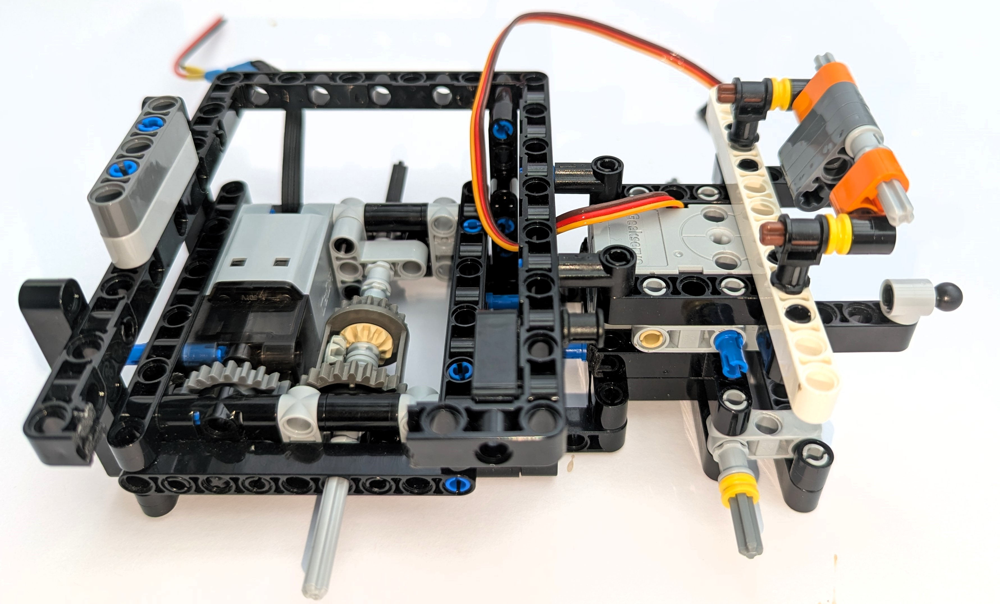

Detailed building instructions for the resulting chassis and the bill of materials can be found in [**Building_Instructions**](./Building_Instructions/README.md).

# Power & Sense Management 

## Sensors

Our analysis of the weaknesses in our previous car model led us to develop a revised sensor concept. We continue to use a gyro (IMU) sensor to determine our orientation on the field. Using one front and one rear camera, we detect lines, obstacles, and walls in the camera’s field of view along the direction of travel. In the immediate vicinity in front of and beside the car, we’ve added a LiDAR sensor to detect objects near the car that the camera cannot (or can no longer) see.

In the previous version of our car, we had an ultrasonic sensor in the front and infrared sensors on the sides. The ultrasonic sensor measured distances in front of the car, while the infrared sensors could only trigger an alarm if something came too close. Our next try were 5 ToFSensors placed on the car's sides. This was already better, but not good enough. The ToFs have a very small field of view, so we had big gaps in our distance measurements. Additionally, the ToFs required the use of an I2C Multiplexer as they all had the same hardcoded I2C address.

 This year, we use a LiDAR to solve the problem to detect obstacles and walls outside the camera's field of view.

|                 | Pros                                                  | Cons                                                         |
| --------------- | ----------------------------------------------------- | ------------------------------------------------------------ |
| **IR Sensors**  | cheap, easy analog signal processing                  | only fixed distance, poor reliability, extremly unreliable with shiny surfaces |
| **ToF Sensors** | very fast, exact measurements                         | become unreliable with longer cables, small FoV              |
| **LiDAR**       | measurements in 1 degree resolution in all directions | 100 msec time between 2 measurements in the same direction   |

### LiDAR

The LiDAR can accurately measure distances in all directions, but it only updates 10 times per second in the same direction. The ultrasonic sensor was only accurate up to about 1 meter, and even then only if the sensor wasn't angled toward the obstacle or wall. The infrared sensors were quite inaccurate and useless on shiny surfaces.

We compared LiDAR models to select a fitting one.

Requirements: 

- housing as small as possible
- short minimum distance
- high sampling frequency
- python programmable  interface

| Parameter          | STP-19L     | RPLiDAR A1  |
| ------------------ | ----------- | ----------- |
| Measuring Range    | 3cm - 12m   | 15cm - 12m  |
| Accuracy           | +/- 10mm    | +/-  45 mm  |
| Scanning frequency | 10 Hz       | 5.5 Hz      |
| Size               | 39x39x34 mm | 97x70x55 mm |
| Weight             | 47 g        | 170 g       |
|                    |             |             |

We chose the STP-19L, especially because it has a very short minimum distance and high accuracy. This allows it to be used within the parking box.

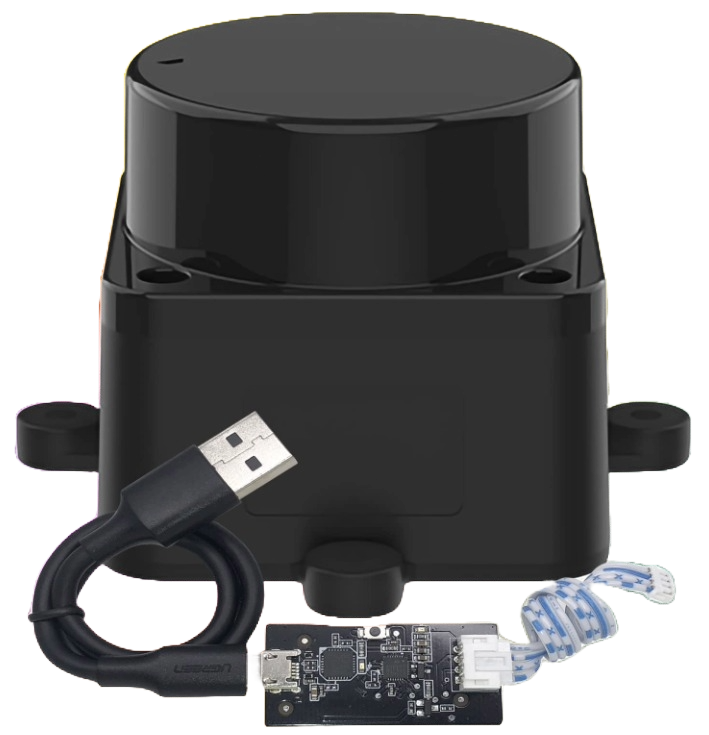

To be able to use the LiDAR while reversing, it must have a 360-degree field of view. This means it must be able to see over all other car components, but it must be mounted significantly lower than 10 cm in order to still detect obstacles and walls. The manufacturer specifies a maximum deviation of 0.2 degrees up or down for the laser. To ensure that the LiDAR does not look beyond the 10 cm mark too early in the more important forward direction due to this inaccuracy, we have tilted it very slightly forward using a thin plastic washer. We have at least one meter of accurate measurement to the front, and to the rear we still have at least 30 cm of measurement range, which is sufficient for our purposes. For each scan, we normalize each of the 360 supplied angle values to a whole number so that we have fixed angular positions.

| LiDAR Laser Position                                | Measurement of Tilt Angle                         |
| --------------------------------------------------- | ------------------------------------------------- |
| 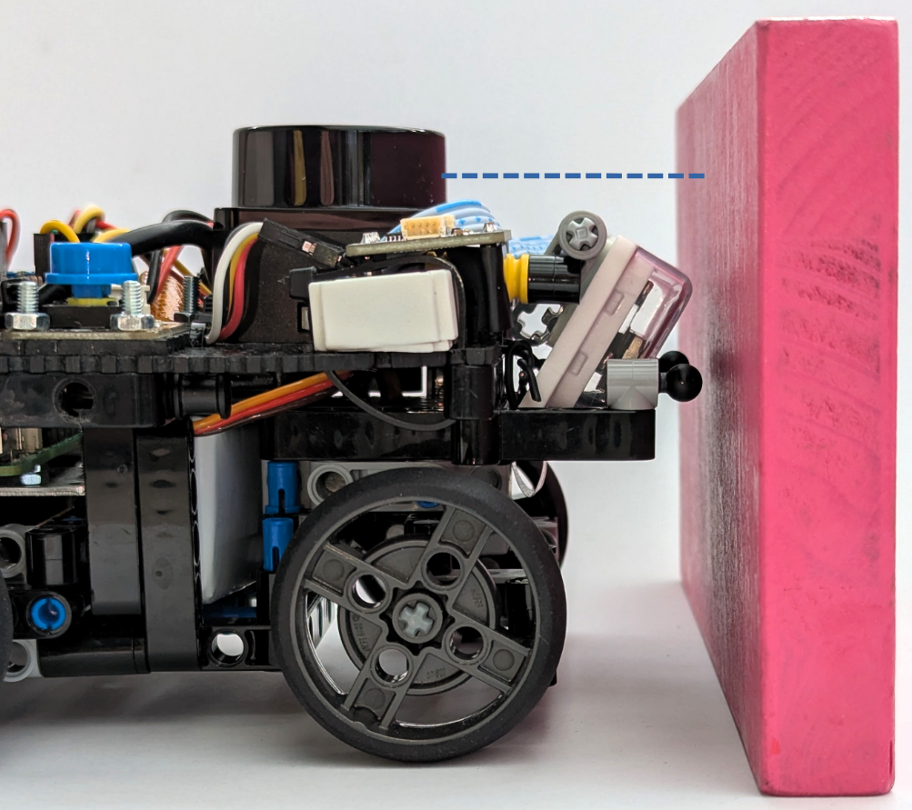 | 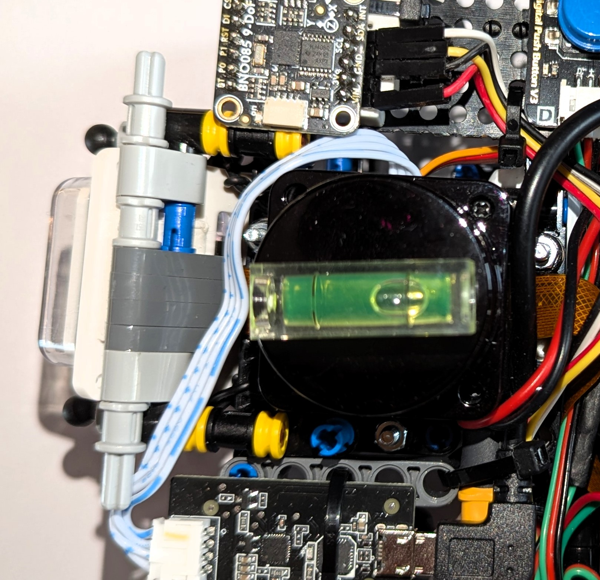 |

### Cameras

To detect obstacles, lines, and walls, you’ll also need a camera. To ensure the Raspberry Pi can see as much of the playing field as possible, we use two wide-angle cameras, front and rear.

Camera selection:

We tested the RPI V3 Wide and Waveshare 160 degree camera.

| Feature                | RPI V3 Wide | Waveshare 160 |
| ---------------------- | ----------- | ------------- |
|                        | 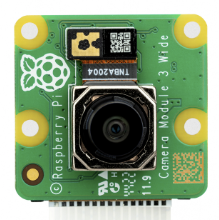 | 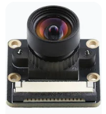 |
| nominal FoV (diagonal) | 120         | 160           |
| Sensor                 | Sony IMX708 | Sony IMX219   |
| max. Resolution        | 4608 × 2592 | 3280 × 2464   |
|                        |             |               |

Resolution is not a criterion as we use a very reduced image resolution to speed up image processing.

The image of the 160 degree camera was too heavily distorted to use it in our image processing algorithms without running an undistort processing first. This costs too much processing time.

Therefore, we selected the Raspberry Pi V3 Wide camera.

We mounted the front camera at a slight angle, directly below the LiDAR sensor. We use these cameras during normal driving to detect obstacles, lines, and walls. The slight tilt ensures that, despite the low position, there are very few non-playing-field areas in the image that we need to crop out. We use the rear camera when parking to look behind us. We use a reduced image resolution of 320x240 pixels so that we can process the images quickly enough. This allows us to capture approximately 25 images per second. The camera theoretically has a field of view of 120 degrees. Due to the camera’s position and the field of view, we’ve measured that we can actually only use an angle of 85 degrees. A higher camera position would actually be better, but then the LiDAR wouldn’t be able to see over the camera, so we had to make a compromise. 

**Camera Calibration**

To ensure accurate color recognition, we increased the brightness and color contrast in the camera settings. To adjust the thresholds for filtering out a color based on local lighting conditions, we wrote a calibration program that writes the thresholds for all colors to a configuration file, which the car reads upon startup.

### Gyro

To determine the car’s current orientation on thefield and its cumulative total rotation, we use an IMU sensor (gyro + accelerometer), the Adafruit BNO085 sensor. This sensor is mounted horizontally at the front, aligned with the car’s longitudinal axis. The sensor has a special operating mode called Game Rotation Vector, which allows it to continuously calculate the orientation relative to the starting position. When the gyro starts up, it automatically calibrates itself so that the current orientation is set as the zero orientation. The BNO085 also has a built-in chip that automatically combines the gyroscope and accelerometer data so that we can read the corrected angles directly. 

A common problem is gyro drift. This occurs when the measured angle does not return exactly to its initial value after a rotational movement, causing the measurement error to accumulate with each lap driven. With the BNO085, the drift is very low due to the combination with the accelerometer, but it is still noticeable. According to the manufacturer’s datasheet, it amounts to approximately 1.5 degrees per full 360-degree rotation. Since this drift is fairly constant, we compensate for it by adding an offset every 90 degrees.

## Power Management

For our new design, we wanted to significantly reduce both the weight and the height. For this reason, we looked for a motor and servo controller with a built-in 5V step-down converter that could also power the Pi. And we wanted to use the smallest possible battery. This required us to perform precise measurements and calculations to ensure that the chosen power source would actually be sufficient to safely power the car through an entire race. Previously, we had used relatively generously sized batteries and hardly ever questioned their capacity. Now, however, we are forced to plan and calculate much more precisely.

First estimation of power consumption (maximum values):

|                                        | Voltage | Current | Power  |
| -------------------------------------- | ------- | ------- | ------ |
| Raspberry Pi (incl. Cameras and LiDAR) | 5V      | 5A      | 25W    |
| Servo                                  | 5V      | 0.5A    | 2.5W   |
| RGB LEDs (4x max. 60 mA)               | 5V      | 0.24A   | 1.2W   |
| Sum at Seengreat 5V Step-Down          |         | 5.74A :exclamation:  | 28.74W :exclamation:|
| Motor                                  | 10V     | 0.5A    | 5W     |
|                                        |         |         |        |

According to tests on Philohome (see sources), the drive motor consumes approximately 500 mA (~5 W) at 10 V under load. 

This presents a problem. The 5 V step-down regulator on the motor driver delivers a total of only 3 A/15 W. The Raspberry Pi 5 alone can draw up to 5 A, which is already too much. So we had to measure exactly what the realistic power consumption is. The LiDAR and cameras are powered directly by the Raspberry Pi, meaning their impact can be seen in the Pi’s total power consumption.

### Power Consumption Check

Seengreat Motor Controller 5V/3A Step-Step-Down: 

- Designed to supply 5V to the Raspberry Pi, servo, and LEDs. Raspberry Pi Test Scenario: 

- Powered via USB-C through a test device.

   Two processes are running on the Pi: one reads and processes camera images as quickly as possible, while the other reads and decodes LiDAR measurement data as quickly as possible.

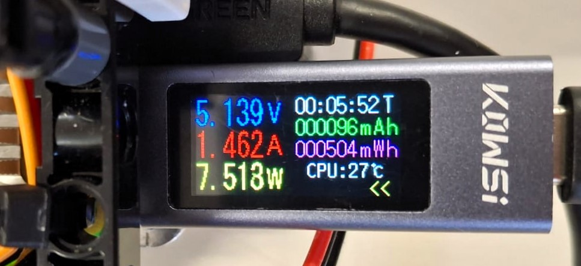

|                                        | Voltage | Current | Power  |
| -------------------------------------- | ------- | ------- | ------ |
| Raspberry Pi (incl. Cameras and LiDAR) | 5.13V   | 1.46A   | 7.5W   |
| Servo                                  | 5V      | 0.5A    | 2.5W   |
| RGB LEDs (4x max. 60 mA)               | 5V      | 0.24A   | 1.2W   |
| Sum at Seengreat 5V Step-Down          |         | 2.2A :heavy_check_mark: | 11.2W :heavy_check_mark:|
| Motor                                  | 10V     | 0.5A    | 5W     |
| Total |         |         | 16.2W :heavy_check_mark:|

The motor controller can handle up to 15 W → fits 16.2 W total power consumption of the car: 16.2 W, max. 20 W is possible (5 W motor + 15 W on the motor controller) 

### Power Supply

For the battery, we’re using the Red Power XT with a capacity of 1,100 mAh and a voltage of 7.4 V (= 8.1 Wh), which is small enough but still provides sufficient runtime.

|      | Length | Width | Height |
| ---- | ------ | ----- | ------ |
| 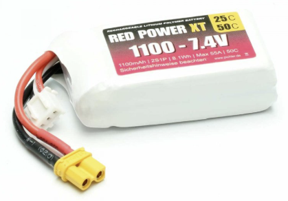 | 55 mm  | 30 mm | 17 mm  |
|      |        |       |        |

Purely mathematically speaking, the battery runs out after about 20 minutes at maximum load. That's more than enough to complete a race without running out of power.

### Power Distribution

This results in the following block diagram of the power supply in our car:

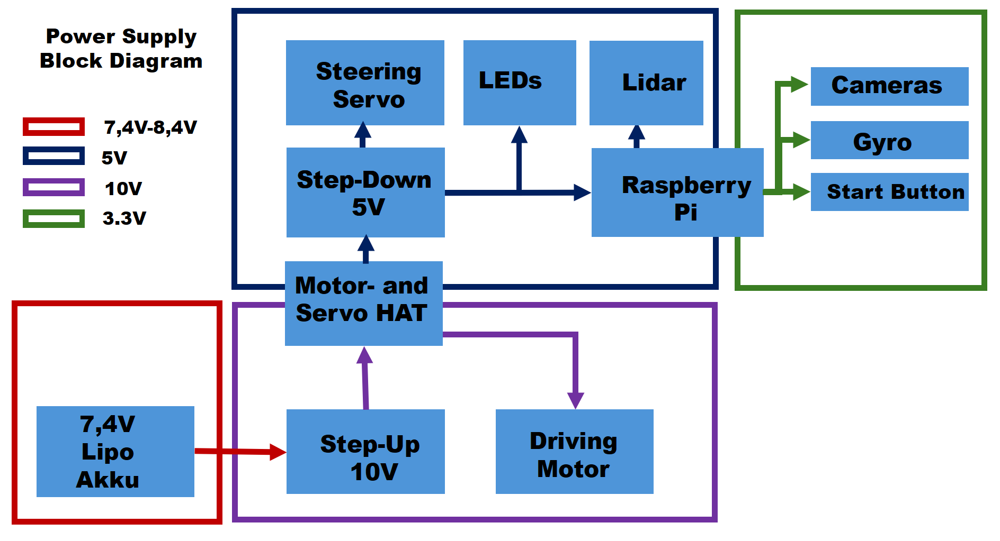

### Wiring Diagram

We created the wiring diagram using the Fritzing software package.
Unfortunately, there was no Fritzing element for our Seengreat Motor and Servo Driver HAT. 
So we looked up the elements and their internal wiring in the manufacturer's docs and included these elements separately in our wiring diagram.
We then drew a blue rectangle to indicate which elements are indeed part of the Seengreat HAT.
These are a 5V-Step-Down, a TB1266FNG Motor driver, a PCA9685 PWM Driver and an on/off switch.

  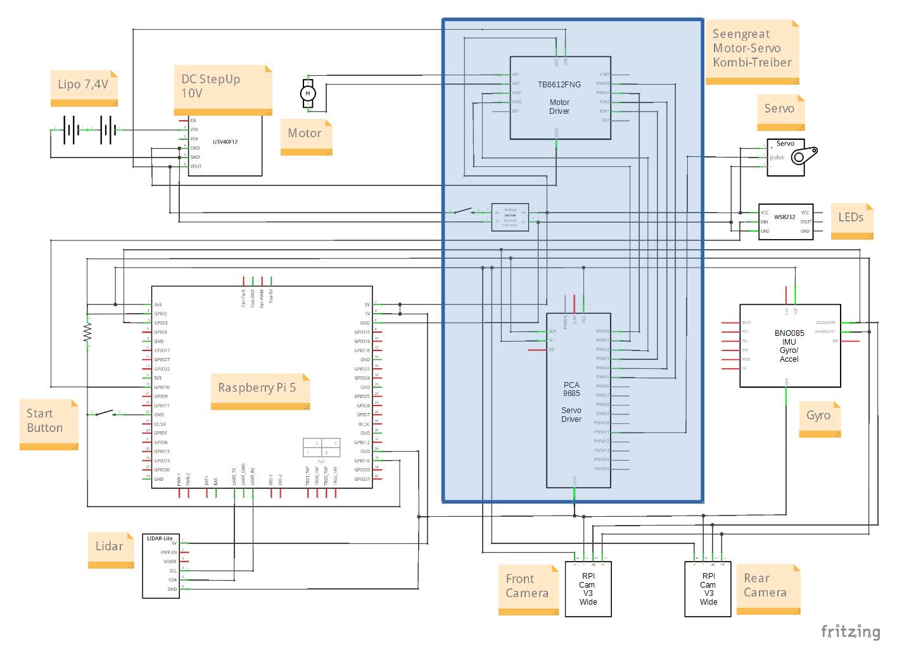

Even though the connections to the Raspberry Pi can be seen in the wiring diagram, we also added this graphic to show which cable color for which purpose goes to the Raspberry Pi headers.
If a cable comes loose, this graphic helps to put it back in place easily.

  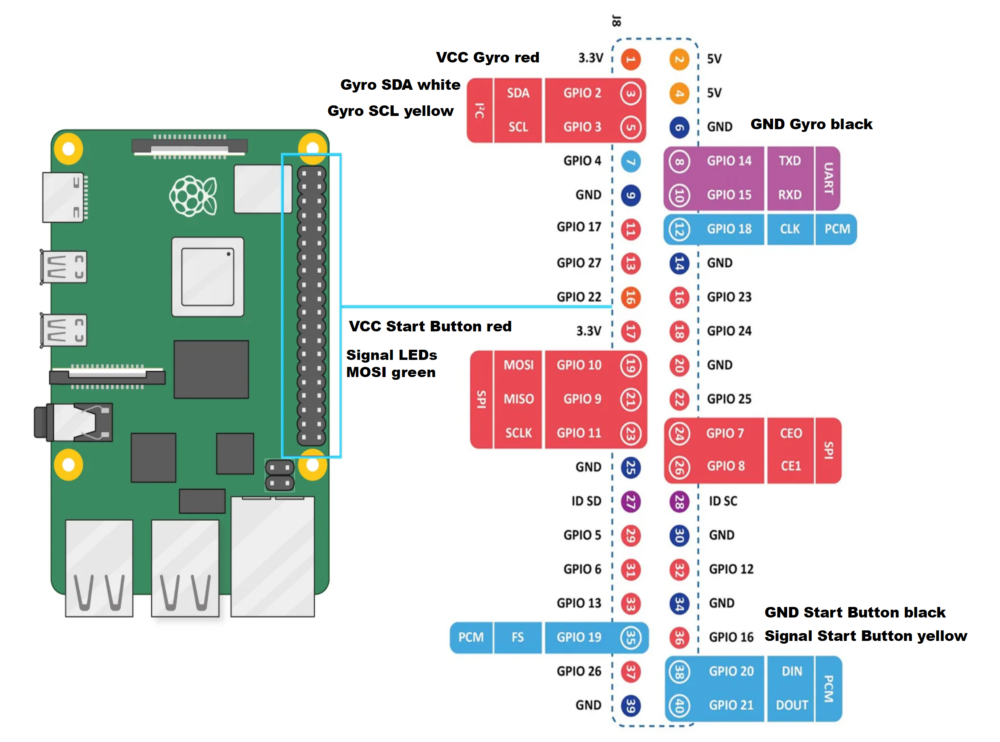

# Software Architecture & Obstacle Strategy 

Code Development

 We developed our code in Python on a Raspberry Pi 5. To interface with the sensors and the motor driver board, we used the corresponding CircuitPython libraries from Adafruit. For image processing, we use the OpenCV library. We developed our functions for reading LiDAR data based on the GitHub project nannigalaxy/ldrobot_lidar. The LiDAR sensor generates high data rates that must be quickly retrieved and processed to ensure we always have up-to-date distance data in all directions. At the same time, the camera images must be read and analyzed quickly enough. The Raspberry Pi 5 has 4 processor cores and thus sufficient computing power. However, due to Python’s architecture, all threads of a Python script always run on the same core. To truly run both tasks in parallel and utilize two cores for this purpose, we have split our software into two processes. The `lidar_reader` process, which processes the LiDAR measurement values, makes these available to the `roadrunner2` main process via shared memory. Since Rule 6.14 prohibits the processing of any measurement values before the start button has been pressed, we have created a second shared memory to provide a start signal to downstream processes. 

Flowchart:

Software Modules: Base Classes At the lowest level are base classes that encapsulate the respective hardware components. We have combined the motor and servo into a *DrivingBase* class, which provides all motion functions. LiDAR, the gyro, the camera, and the LEDs are each separate classes. The gyro class not only provides the current orientation on the playing field but also the cumulative total rotation since startup. The camera function already provides a BGR (Blue-Green-Red) image and an HSV (Hue-Saturation-Value) image to make it easier to filter colors. We manage the car’s current state and all the information needed for the next steering decision in a RoadrunnerState class. We use GitHub for source code management.

Preprocessing:

The layer above contains classes for preprocessing camera images and LiDAR data. To process the LiDAR data, we first determined and stored the car’s own dimensions in terms of LiDAR distances. This allows us to calculate, based on the current measurement data for each angle, how far away from the car—not just from the LiDAR—an object (such as a wall or obstacle) is located. The preprocessing determines the shortest distance from the car and the corresponding angle for each of three zones (260 to 359 degrees, 350 to 10 degrees, 0 to 100 degrees). This data is later combined with camera or gyro data for steering decisions. From the BGR camera image, we filter out the black walls and use the maximum height to determine whether there is a risk of collision on the right or left. From the HSV image, we filter out the lines, obstacles, and the parking barrier. We then treat the parking barrier as a wall and calculate whether there is a risk of collision on the right or left. In each case, we use only the line color that matches the direction of travel. The direction of travel is determined at the start of the parking maneuver by which side of the magenta wall in front of the camera the exit is visible. We keep track of how many lines (of the correct color) we have already driven over and calculate the new straight-ahead gyro course at each line.

Steering Decision

While Driving in Circles The Roadrunner then calculates its next steering decision based on the preprocessed data. 

Priority 1: Avoid the parking space If the magenta-colored parking space appears too high or too close in the camera image, the car avoids it with a brief steering maneuver. 

Priority 2: Avoiding Walls If a wall is too high or too close, the car avoids it with a short steering movement away from the wall.

Priority 3: Avoiding Obstacles If an obstacle is in the image, our car steers so that the obstacle moves all the way to the left (red) or all the way to the right (green) in the image. This year, we’ve also introduced a graduated evasion strategy. Depending on how close we already are to the obstacle, we steer toward a different position—the target column of the obstacle’s center in the image—and thus gradually move the obstacle sideways out of the frame. Formula: steering angle = servo center + steering factor * (actual column in the image - target column) However, the camera loses sight of the obstacle before we have passed it by far enough. In the example shown in the diagram, our car would, without further action, attempt to steer past the green obstacle on the left and thereby drive around the red obstacle. 

Solution: Combining camera data with LiDAR data. The LiDAR function “shortest distance between 260 degrees and 359 degrees” or between 0 and 100 degrees continues to detect that there is still an obstacle directly to the left of the car. We have defined a “safety zone” with a 12-centimeter radius around the outline of our car. Before our car steers left or right to avoid an obstacle, it first uses LiDAR to check whether there is still something within the safety zone in the desired steering direction. If so, the car continues straight ahead for the time being. If the safety zone is clear, it swerves to avoid the obstacle.

Priority 4: Steer to gyro straight-ahead course. The current straight-ahead course is stored in the StateModule. When steering using the gyro to maintain a straight-ahead course, the same problem can occur as when steering around obstacles. Example: If the car crosses a blue line, the straight-ahead course changes by 90 degrees to the left. However, if there is a red obstacle directly in front, the car must first pass it before it is allowed to turn left. Here, too, the car may lose sight of the obstacle in the camera image before it has passed far enough past it. To prevent the car from hitting the obstacle while turning, the straight-ahead course control system also checks whether anything appears in the LiDAR safety zone (12 cm around the front of the car) in the direction the car is supposed to turn.

Main Program

We use the same program for the opening race and the obstacle race. In the obstacle race, we always start from the parking box. After pressing the start button, we first check whether the magenta-colored parking box is visible in the image. If so, the program enters “Obstacle” mode; otherwise, it enters “Open” mode. In “Obstacle” mode, a separate “Exit Parking” module runs first before the normal loop for driving the laps is executed. After completing the laps, the car performs the parking maneuver while still in Obstacle mode. When parking, the car drives past the parking box, turns toward the outer wall, makes a U-turn, and then drives close to the parking box until the LiDAR detects the front wall of the parking box next to the car. It then turns toward the inner wall and parks in reverse. As it does so, it steers so that the black rear wall appears exactly in the middle between the two magenta side walls in the camera image. 

# Debugging & Testing 

To identify driving errors, crashes, and similar issues, it is important to be able to observe the car while driving and record data at the same time. We have developed several mechanisms for this purpose.

LEDs 

The four RGB LEDs on the back of the car are used, first, to indicate the startup status and when the car is ready for the start button. In addition, while driving, they provide visual feedback when a line has been detected or when an obstacle of a specific color has been detected on a specific side. They also indicate a “too close” alert, which is calculated from the LiDAR data. This makes it easy to observe while driving whether the car is evaluating key measurement data as expected and responding accordingly.

Logging

 While driving, we write a log file that records measurement data and steering decisions. In addition to the actual log message, each line contains a precise timestamp. We use try-catch blocks to handle crashes in our software and record their cause in the log file. Python is an interpreted language, so even typos and similar errors that the parser doesn’t immediately detect can cause crashes while driving.

LiDAR Logger 

To record LiDAR measurement data, we have created an additional LiDAR logger process. It also hooks into the start signal and the shared-memory array containing the distance measurements. Ten times per second, it writes the entire array as a comma-separated line to a CSV file. Since this begins exactly at the start signal, the data can later be analyzed using tools like Matplotlib and assigned to specific driving situations.

Camera Video

 We also have the option of recording the camera frames as a video in real time. In this case, we overlay the detected obstacles and lines as colored markers so that it is clear whether the car has interpreted the image correctly.

Test 

During testing, we first ran multiple tests using random combinations of obstacles. For some combinations, we identified an increased risk of driving errors. Using the tools described above, we then determined the specific cause of each driving error and, where necessary, added additional log messages. Once we found a solution, we tested it at least 5–10 times with that combination and other obstacle combinations that, in theory, should cause the same problem. This ensured that the solution was truly effective and had no adverse side effects. We also used this method to optimize parameter settings such as the size of the LiDAR safety zone or the gradations in the steering angle formula.

# Overall System & Engineering Decisions

Technical Specifications

 Length: 18.8 cm, Width: 13.5 cm, Height: 9.5 cm (without Roadrunner pilot) 16.5 cm with Roadrunner pilot Weight: 572 g, Speed: max. approx. 1 m/s

## Development Goals

We analyzed the issues that our previous car model still has and how they could be resolved. 

Our guiding principle is: accuracy over speed.

The camera loses sight of an obstacle well before the car has completely passed it. If the car then detects another obstacle and steers toward the first obstacle to avoid the second one, it may knock the obstacle over. So far, we’ve been estimating when the car has actually passed the obstacle. However, this is rather imprecise and works better or worse depending on the driving angle. When parking, we tried using IR sensors to measure the distances within the parking space. However, this didn’t work well because the IR sensors were too unreliable. A LiDAR system capable of 360-degree all-around measurement seems like a sensible solution to both problems. Problem: To achieve this, the entire car—including the LiDAR—must be built to be less than 10 cm thick, which is a challenge. Overall, a smaller car has more space on the playing field, which is why we reduced both the length and width in previous versions. This year, we’ve also significantly reduced the height to well under 10 cm (excluding the Roadrunner pilot :-)) and lowered the weight. The image below shows the evolution of the Roadrunner versions toward an increasingly compact car.

## Design Trade-Offs

- LiDAR vs ToF Sensors
- LiDAR and Chassis height
- chassis height (wheel size) and speed
- speed and rear axle gearing
- motor choice: speed, gearing and pwm frequency stability
- previous car: separate motor controller and servo controller.
- this year: goal: use combined controller to save space and build flat enough for LiDAR
- test 3 types: adeept robot hat 3.0, waveshare robot driver hat and Seengreat motor and servo hat.
- problem: only 1 pca9685 pwm driver for both motor pwm and servo pwm.
  - servo: needs 50 Hz pwm frequency, motors: typically uses a lot higher frequency -> not possible with only 1 pwm driver
  - original lego PFL Motor rattles loudly at low speed and 50 Hz, CaDa rattles much less due to better gearing quality
  - disadvantage 1 pwm driver acceptable for CaDa motor, so combined but smaller controller is better

- LiDAR and Camera position
- LiDAR, python GIL and software design

# Appendices

## Hardware Bill of Materials 

The complete Bill of Materials is found in the Building Instructions

## Software Modules

- Raspbian Bookworm Operating System
- OpenCV image processing
- Adafruit Blinka (Interface to circuitpython/micropython libs for electronic hardware modules)
- Adafruit_CircuitPython_BNO08x
- Adafruit-PCA9685
- GitHub: nannigalaxy/ldrobot_lidar

## Resources

