
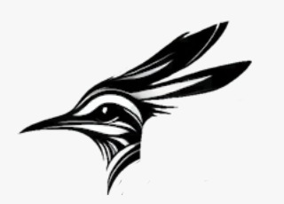

# Car Photos

In this section, we show photos of our car from all angles, one set witout labels and one setwith explaination labels.

## High resolution car photos without labels

### Front
[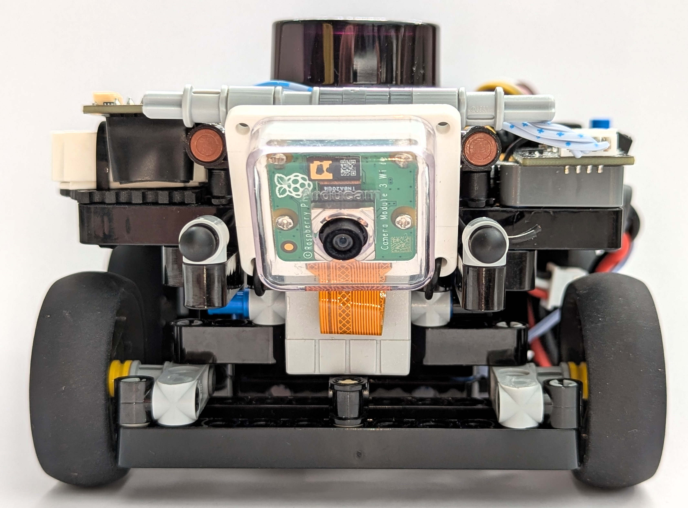](v-photos/front.jpg)

### Back
[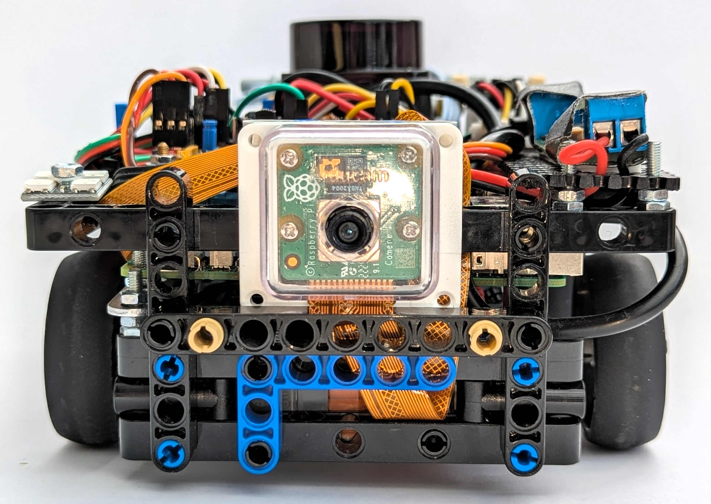](v-photos/back.jpg)

### Top
[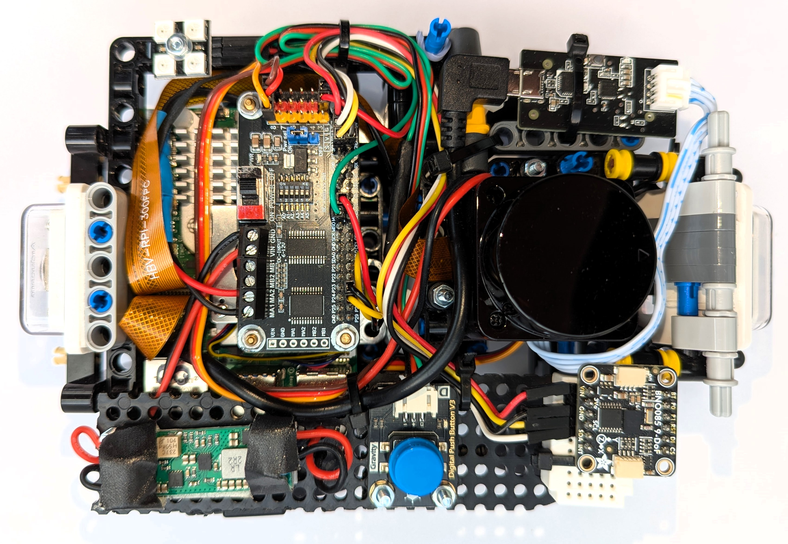](v-photos/top.jpg)

### Bottom
[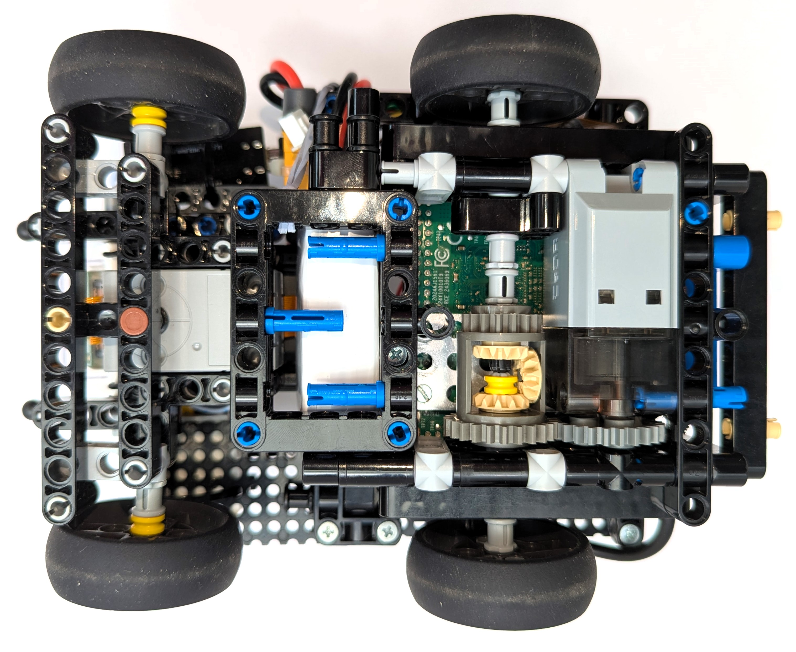](v-photos/bottom.jpg)

### Right
[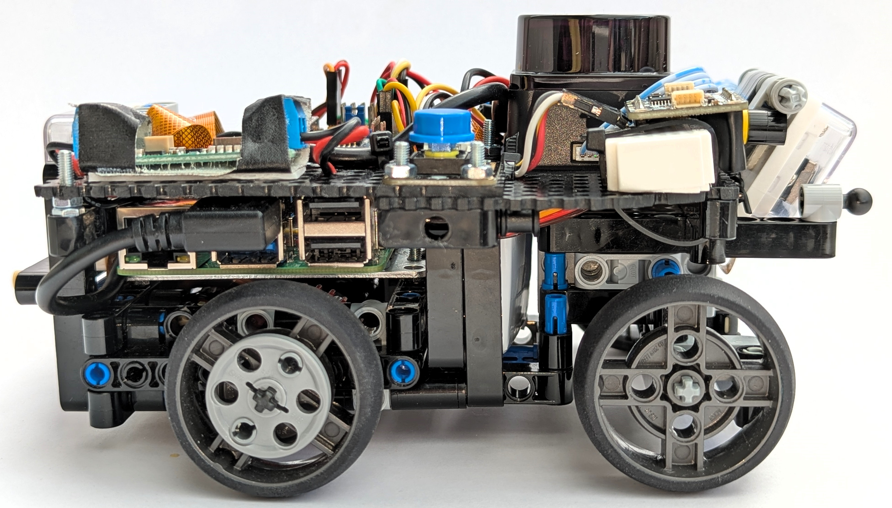](v-photos/right.jpg)

### Left
[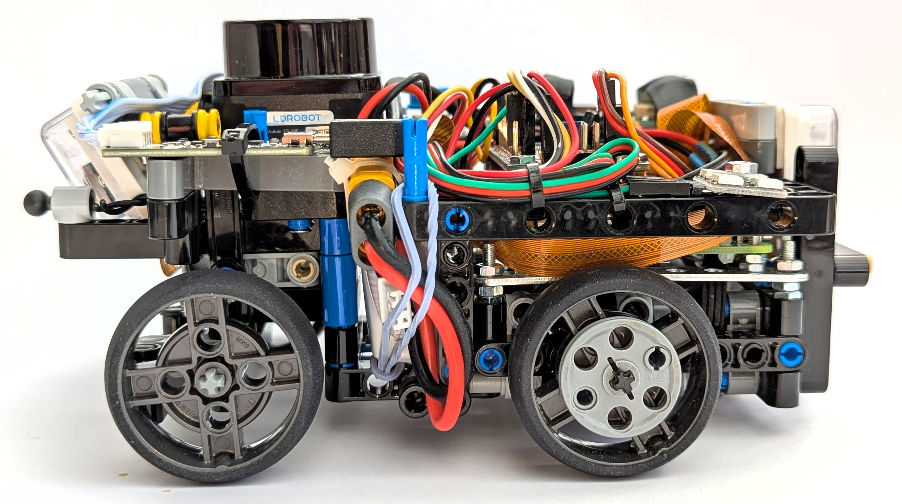](v-photos/left.jpg)

---

## High resolution car photos with labels

### Front with labels
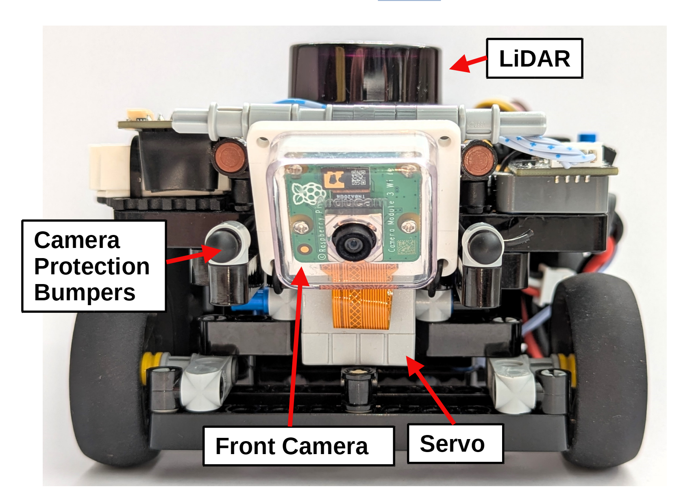

### Back with labels
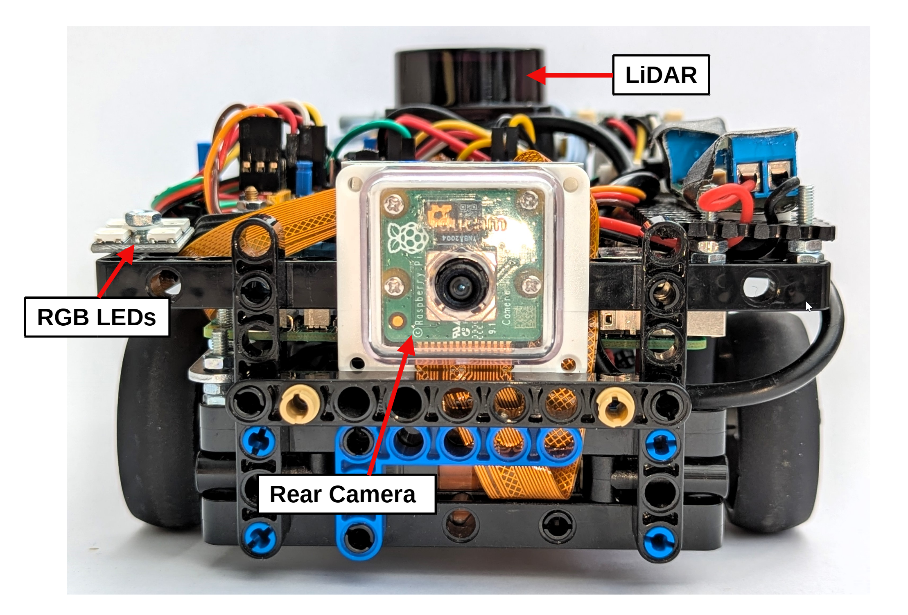

### Top with labels
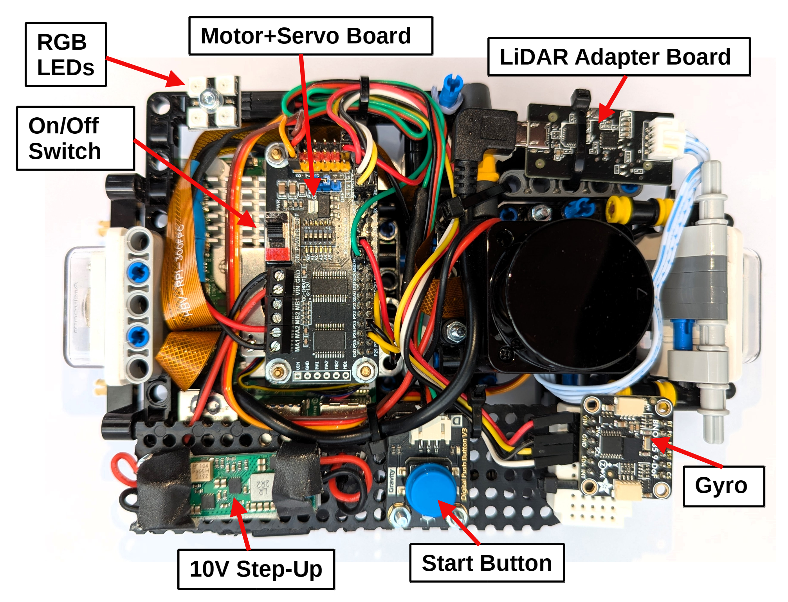

### Bottom with labels
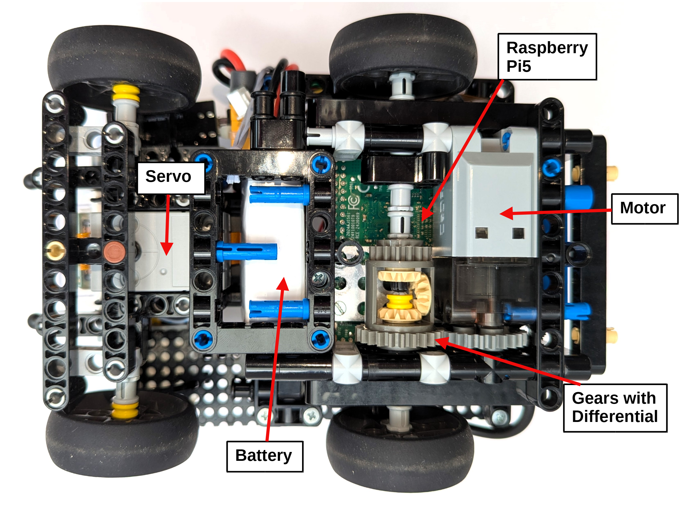

### Right with labels
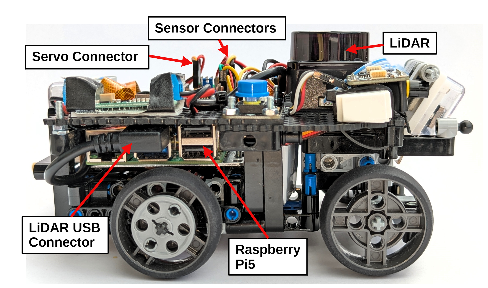

### Left with labels
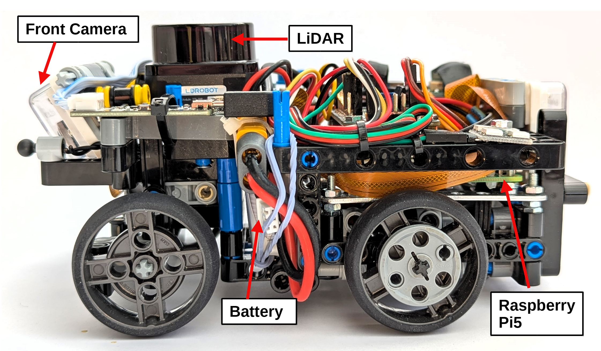

[Back to main page](../README.md)
