
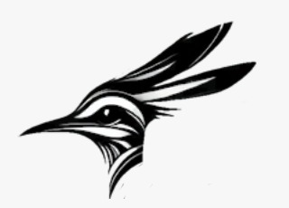

# Car Photos

In this section, we show photos of our car from all angles, one set without labels and one set with explanation labels.

## High resolution car photos without labels

### Front
[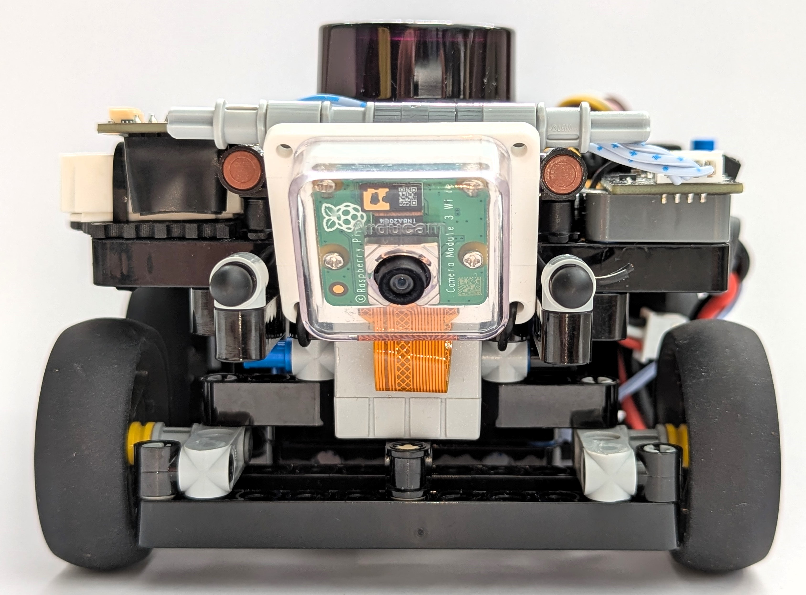](front.jpg)

### Back
[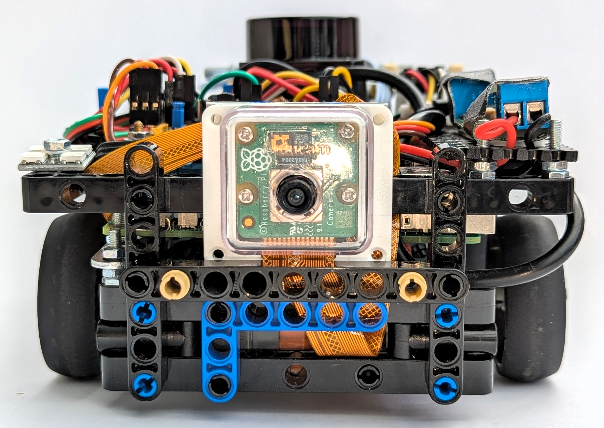](back.jpg)

### Top
[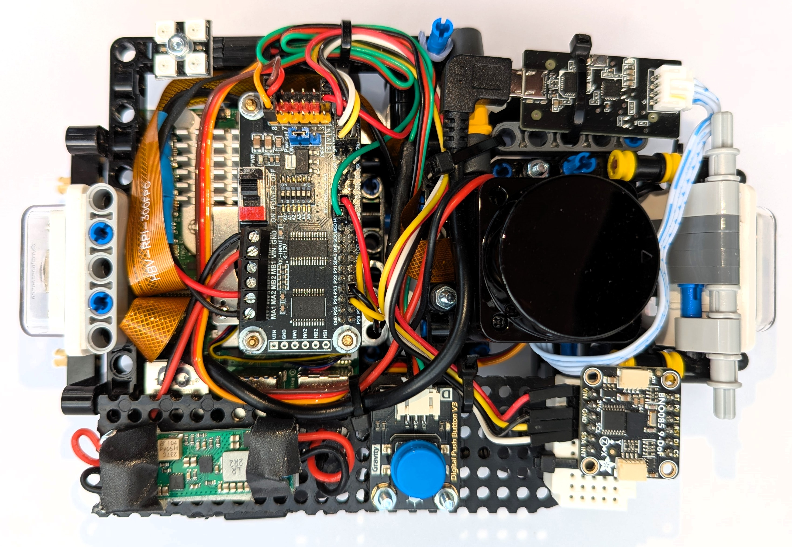](top.jpg)

### Bottom
[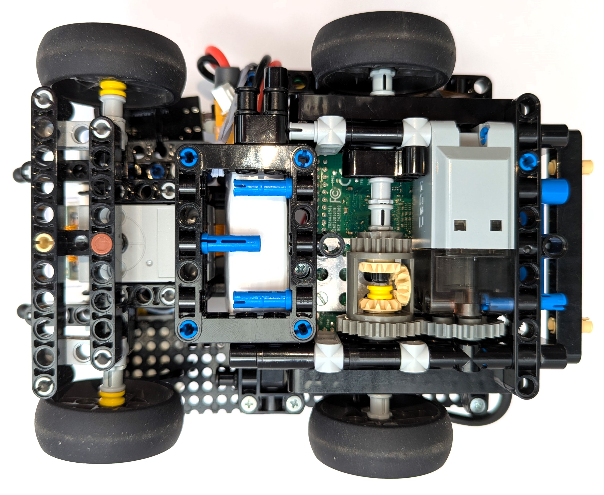](bottom.jpg)

### Right
[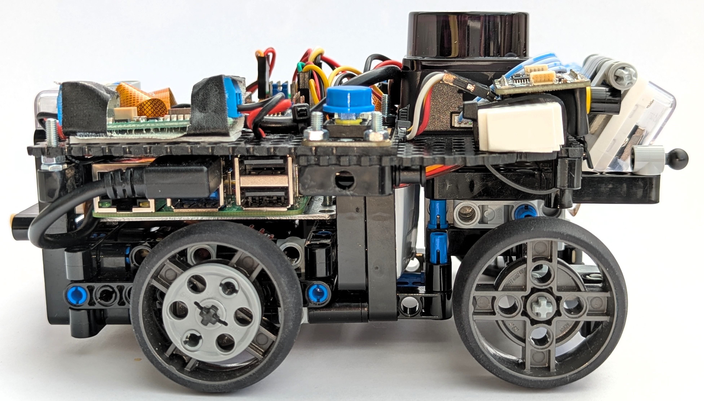](right.jpg)

### Left
[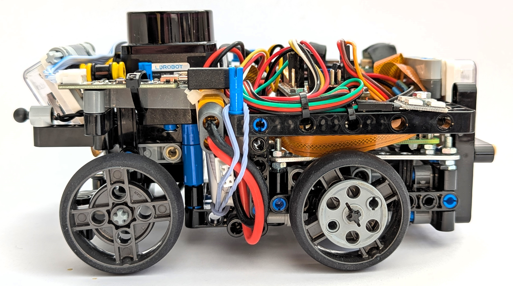](left.jpg)

---

## High resolution car photos with labels

### Front with labels
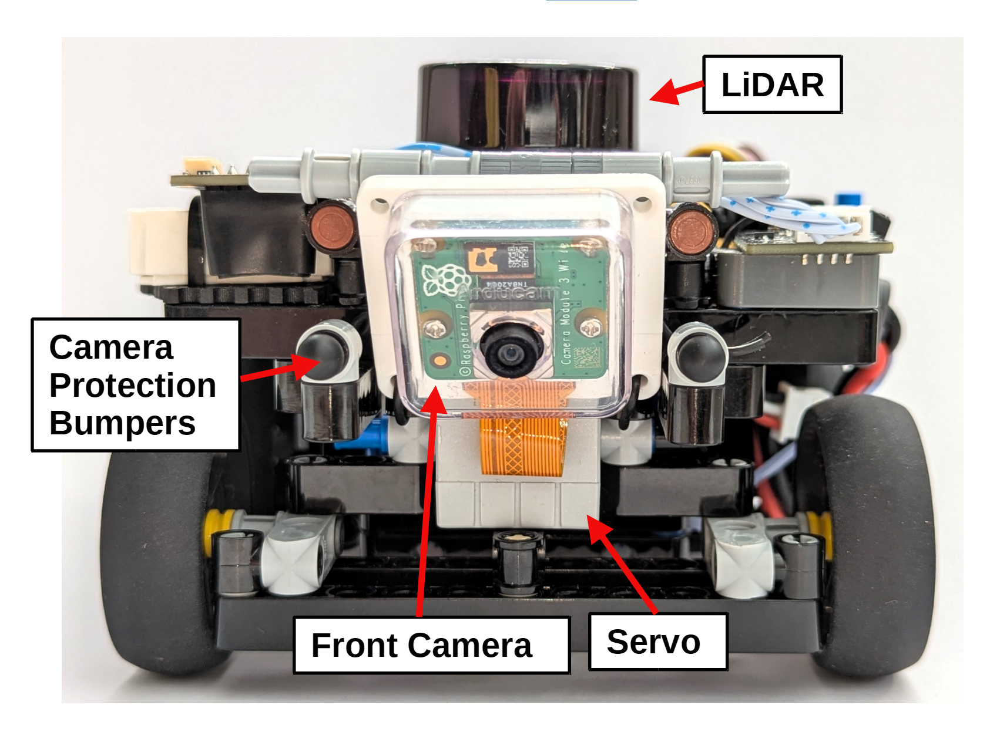

### Back with labels
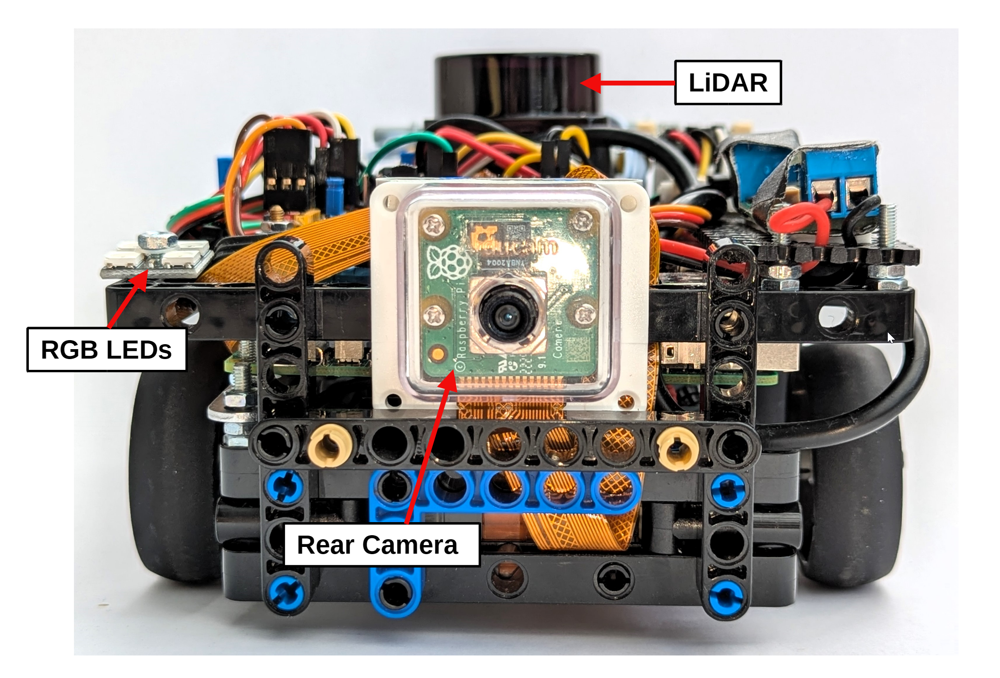

### Top with labels
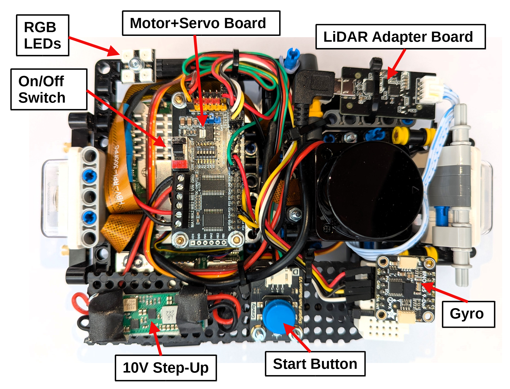

### Bottom with labels
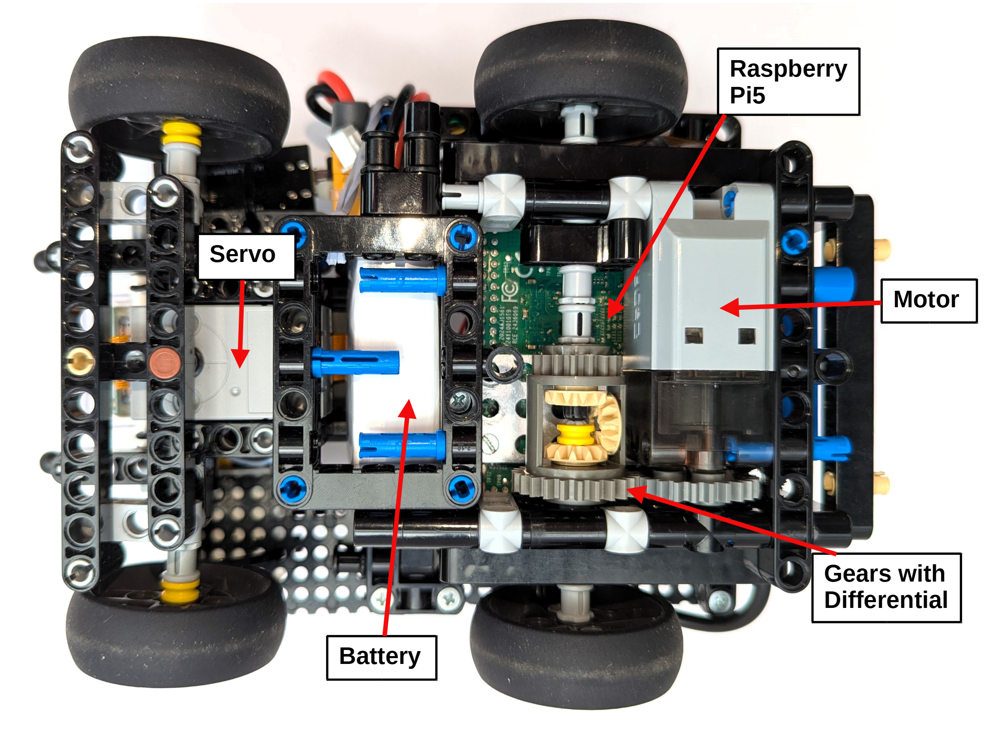

### Right with labels
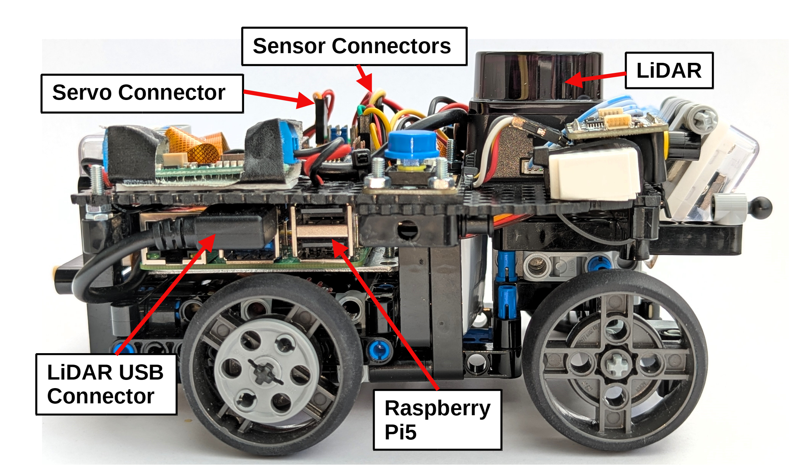

### Left with labels
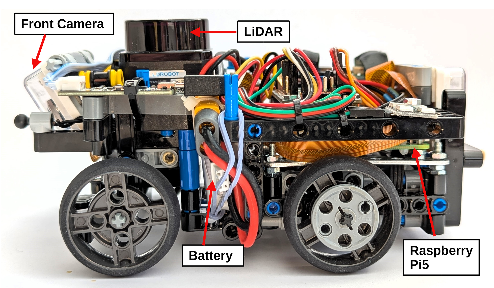

[Back to main page](../README.md)
