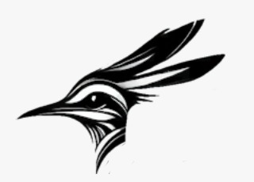
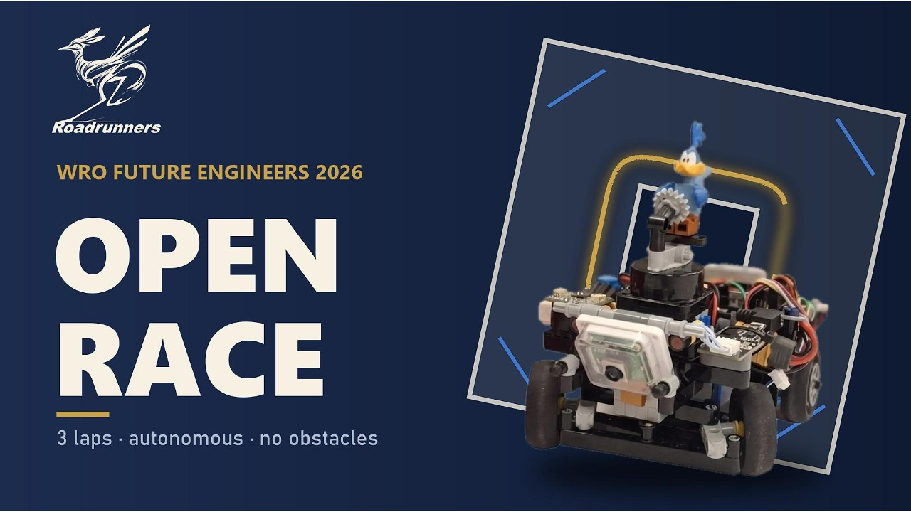
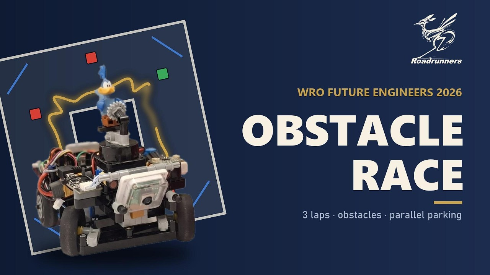
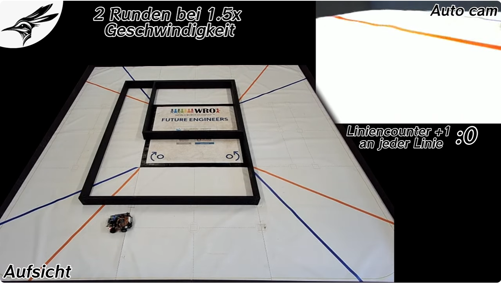
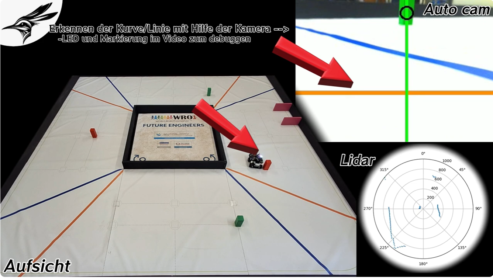

## 
Performance Videos

In this directory you will find several video links. The videos show our car performing in both the Open race and the Obstacle Race including a parallel Onboard-Camera View, LiDAR Data and explanations. 

The pictures below are clickable and link directly to the corresponding Youtube videos.
If not working the videos can be found under these links:

### Video Links for International Finals:

https://www.youtube.com/watch?v=UgvTucSaBBo

https://www.youtube.com/watch?v=2qhBaNxagVk

### Video Links for German National Finals:

https://www.youtube.com/watch?v=euGolSq_b-Y

https://www.youtube.com/watch?v=kO0WY9evncY

---
# Video Links for International Finals:

## Open race

## Obstacle race

# Video Links for German National Finals:

## Open race

## Obstacle race

